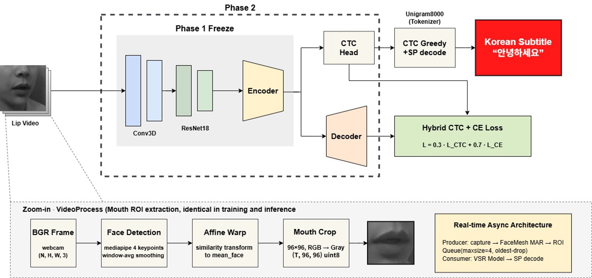
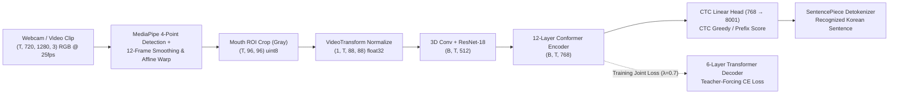
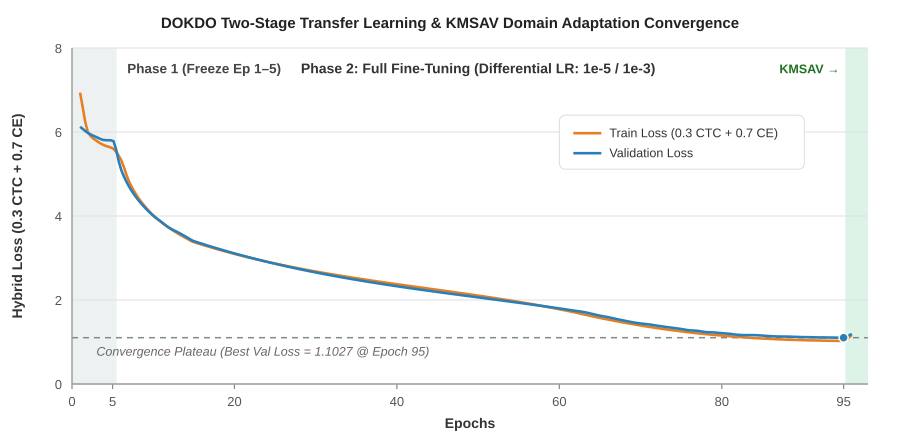
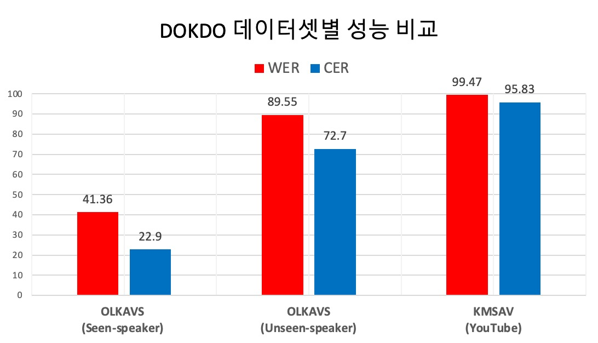

<div align="center">

# DOKDO: On-Device Korean Lip-Reading System via Two-Stage Transfer Learning

**Real-World Validation of an On-Device Korean Lip-Reading System Based on Transfer Learning**  
*(전이학습 기반 온디바이스 한국어 립리딩 시스템의 실환경 검증)*

[](https://huggingface.co/dlvusgks/dokdo-vsr)
[](https://www.python.org/)
[](https://pytorch.org/)
[](#)
[](LICENSE)

<h3>
  <b>🇺🇸 English</b> &nbsp;|&nbsp; <a href="README_KO.md"><b>🇰🇷 한국어 (Korean)</b></a>
</h3>



<p align="center">
  <b>Figure 1.</b> Overall architecture of DOKDO: (Left) Asynchronous MAR-based Producer–Consumer webcam pipeline, (Center) 3D-CNN + ResNet-18 + 12-Layer Conformer visual backbone, and (Right) Two-stage transfer learning with Hybrid CTC + Attention CE loss and Korean SentencePiece Unigram (8,001 tokens).
</p>

</div>

---

## 📑 Table of Contents
1. [Overview & Key Contributions](#1-overview--key-contributions)
2. [Inherited Backbone vs. DOKDO Korean Adaptations](#2-inherited-backbone-vs-dokdo-korean-adaptations)
3. [Model Architecture & Tensor Pipeline](#3-model-architecture--tensor-pipeline)
4. [Two-Stage Transfer Learning & Hybrid Objective](#4-two-stage-transfer-learning--hybrid-objective)
5. [Quantitative & Qualitative Results (OLKAVS & KMSAV)](#5-quantitative--qualitative-results-olkavs--kmsav)
6. [On-Device Webcam Pipeline & Latency Measurement Protocol](#6-on-device-webcam-pipeline--latency-measurement-protocol)
7. [Repository Structure & Code Mapping](#7-repository-structure--code-mapping)
8. [Setup & End-to-End Reproducible Commands](#8-setup--end-to-end-reproducible-commands)

---

## 1. Overview & Key Contributions

Visual Speech Recognition (VSR) reconstructs spoken text solely from lip movements without audio signals. Most prior Korean lip-reading studies focused on isolated word classification or did not publicly release their tokenizers, training scripts, pretrained weights, and real-time webcam pipelines.

**DOKDO** transfers spatiotemporal visual representations from a large-scale English VSR backbone ([Auto-AVSR](https://github.com/mpc001/auto_avsr) / [Chaplin](https://github.com/amanvirparhar/chaplin)) to Korean and validates an end-to-end on-device Korean lip-reading system running locally on a single consumer laptop (MacBook Pro M5 Pro CPU) with a built-in webcam.

* **Korean SentencePiece Unigram Vocabulary (`8,001` tokens)**: Replaces the 5,049-unit English output layer with an 8,000-subword Korean Unigram vocabulary plus a dedicated CTC blank token (`id=8000`) tailored to Korean agglutinative morphology (stems, endings, and particles).
* **Two-Stage Differential-LR Transfer Learning & Domain Adaptation**: Combines a 5-epoch head warm-up stage (visual backbone frozen) with full fine-tuning using differential learning rates (`1e-5` for the Conformer backbone vs. `1e-3` for the Korean head/decoder) under a Hybrid CTC/CE objective ($L = 0.3 L_{\text{CTC}} + 0.7 L_{\text{CE}}$). Achieves **22.90% CER and 41.36% WER** on the OLKAVS Seen-speaker benchmark (**14.37%p** lower CER than prior visual-only Korean VSR work on the same dataset).
* **On-Device Asynchronous Webcam Pipeline**: Integrates MediaPipe 4-keypoint affine ROI normalization with a 3D Mouth Aspect Ratio (MAR) utterance detector and an asynchronous Producer–Consumer queue (`maxsize=4`), achieving **6.61 s** average processing time per 5.0 s utterance on an Apple M5 Pro CPU without external server communication.

---

## 2. Inherited Backbone vs. DOKDO Korean Adaptations

The table below clearly separates the modules inherited from the English pretrained model from the components designed and implemented in DOKDO:

| Component / Stage | Origin | Parameters | Specification & Role | Source Files |
| :--- | :---: | :---: | :--- | :--- |
| **Visual Frontend** | Inherited<br>(LRS3 Pretrained) | `~11.2M` | 3D Conv (`5x7x7`, temporal stride 1) + 2D ResNet-18 extracting 512-D visual features per frame | `espnet/nets/pytorch_backend/backbones/` |
| **Conformer Encoder** | Inherited<br>(Fine-tuned in Phase 2) | `~231.4M` | 12-Layer Conformer (`adim=768`, `aheads=12`, `eunits=3072`, Macaron FFN + MHSA + Conv `kernel=31`) | `espnet/nets/pytorch_backend/conformer/` |
| **Korean Tokenizer** | **DOKDO (Ours)** | `8,001` vocab | Korean SentencePiece Unigram (`<unk>=0, <s>=1, </s>=2`, subwords `3..7999`, `CTC blank=8000`) | `Train/train_tokenizer.py`<br>`Train/tokenizer_utils.py` |
| **Output Heads & Decoder** | **DOKDO (Ours)** | `~12.3M` | Replaced 5,049-unit English head/decoder with 8,001-unit Korean `ctc.ctc_lo` and 6-Layer Transformer Decoder | `Train/model.py`<br>`pipelines/model_korean.py` |
| **2-Stage Transfer Learning** | **DOKDO (Ours)** | `254.9M` total | Phase 1 (Epochs 1–5) backbone freeze $\rightarrow$ Phase 2 (Epochs 6–109) differential LR (`1e-5` vs. `1e-3`) + Hybrid loss ($0.3 L_{\text{CTC}} + 0.7 L_{\text{CE}}$) & OLKAVS $\rightarrow$ KMSAV curriculum | `Train/train.py`<br>`Train/plot_loss.py` |
| **On-Device Webcam Pipeline** | **DOKDO (Ours)** | — | MediaPipe 4-keypoint affine ROI crop (`96x96` $\rightarrow$ `88x88`) + Manual E2E & Async MAR Producer–Consumer Queue (`Queue(maxsize=4)`) | `demo_webcam.py`<br>`util/lip_tracker_dokdo.py`<br>`pipelines/pipeline_korean.py` |

---

## 3. Model Architecture & Tensor Pipeline



| Pipeline Stage | Tensor Shape | Data Type | Operation & Parameters |
| :--- | :---: | :---: | :--- |
| **1. Raw Video Frames** | `(T, H, W, 3)` | `uint8` | `1280x720 @ 25fps` RGB frame sequence |
| **2. Mouth ROI Extraction (`VideoProcess`)** | `(T, 96, 96)` | `uint8` | MediaPipe 4-keypoint detection $\rightarrow$ 12-frame moving-average smoothing $\rightarrow$ similarity affine warp to LRS3 mean face (`256x256`) $\rightarrow$ `96x96` grayscale mouth crop |
| **3. Spatial Transform (`VideoTransform`)** | `(B, 1, T, 88, 88)` | `float32` | `/ 255.0` scaling $\rightarrow$ `88x88` crop (Train: RandomCrop + HorizontalFlip(0.5) / Infer: CenterCrop) $\rightarrow$ `Normalize(mean=0.421, std=0.165)` |
| **4. Spatiotemporal Visual Frontend** | `(B, T, 512)` | `float32` / `bf16` | 3D Conv (`5x7x7`, temporal stride 1) + 2D ResNet-18 |
| **5. Conformer Encoder** | `(B, T, 768)` | `float32` / `bf16` | 12 Conformer blocks (`adim=768`, `eunits=3072`, `aheads=12`, `cnn_kernel=31`) |
| **6. Korean Output Head & Decoding** | `(B, T, 8001)` | `float32` | `ctc.ctc_lo` projection $\rightarrow$ CTC Greedy ($\arg\max \rightarrow$ collapse duplicates $\rightarrow$ drop `blank=8000`) $\rightarrow$ SentencePiece detokenization |

---

## 4. Two-Stage Transfer Learning & Hybrid Objective

### 4.1 Hybrid CTC + Attention Cross-Entropy Objective
During training (`Train/model.py`, `Train/train.py`), the model jointly optimizes frame-level CTC alignment loss and autoregressive Transformer Decoder Cross-Entropy loss (with label smoothing `0.1`):

$$L = \lambda L_{\text{CTC}} + (1 - \lambda) L_{\text{CE}}, \quad \lambda = 0.3$$

* **Distinction Between Training Path and On-Device Inference Path**:
  * **Training**: Both the CTC head ($\lambda = 0.3$) and the 6-layer Transformer Decoder ($1 - \lambda = 0.7$, teacher-forced with `sos_id=1, eos_id=2`) are active so the Conformer encoder internalizes Korean word-order and contextual representations.
  * **On-Device Inference (`decode=ctc`, Default)**: Bypasses the autoregressive Transformer Decoder—which is the primary latency bottleneck on CPU—and runs **Visual Frontend + Conformer Encoder + CTC Linear Head (`ctc.ctc_lo`) with CTC Greedy decoding**, achieving fast on-device execution. Joint CTC/Attention beam search remains selectable via `--decode hybrid`.

### 4.2 Two-Stage Differential-LR Schedule & Convergence Curve

<div align="center">
  
  <p align="center"><b>Figure 2.</b> Training and validation loss convergence across Phase 1 (Encoder frozen, Epochs 1–5), Phase 2 (Full fine-tuning with differential LR on OLKAVS, Epochs 6–95), and Stage 2 KMSAV domain adaptation.</p>
</div>

| Training Phase | Epochs | Trainable Modules | Frozen Modules | Learning Rate (`AdamW`, `wd=0.01`) | Purpose & Behavior |
| :--- | :---: | :--- | :--- | :---: | :--- |
| **Phase 1<br>(Head Warm-up)** | **Epoch 1 – 5** | Korean CTC Head + Decoder<br>(`12.3M` params) | Visual Frontend + Conformer Encoder (`242.6M` params) | `LR_HEAD = 1e-3`<br>(3-ep linear warmup + Cosine) | Stabilize randomly initialized 8,001-class Korean head without corrupting pretrained visual features |
| **Phase 2<br>(Full Fine-Tuning)** | **Epoch 6 – 109** | **Entire Network**<br>(`254.9M` params) | None (All Unfrozen) | `LR_ENCODER = 1e-5`<br>`LR_HEAD = 1e-3`<br>(CosineAnnealingLR) | Apply 100x lower LR to the backbone to adapt to Korean lip articulation while preventing catastrophic forgetting |
| **Stage 2 Domain Adaptation<br>(OLKAVS $\rightarrow$ KMSAV)** | Sequential Fine-Tuning | Entire Network | Same Phase 1 $\rightarrow$ 2 schedule | Initialize from OLKAVS best ckpt via `--pretrained_kr_ckpt` | Adapt studio-trained Korean VSR model (OLKAVS, ~1.5 TB) to wild YouTube videos (KMSAV, ~100 GB) |

---

## 5. Quantitative & Qualitative Results (OLKAVS & KMSAV)

### 5.1 Quantitative Benchmark Comparison

> 📌 **Definition of "Natural Sentence Utterances (자연발화)"**: Here, *natural utterance* refers to **continuous multi-word sentence-level speech** containing everyday vocabulary and grammatical particles (in contrast to isolated word or digit classification in earlier Korean lip-reading studies), rather than unscripted spontaneous conversation.

| Model / Study | Input Modality | Backbone & Decoding | Dataset | Split Condition | WER (%) | CER (%) | Open-Source Code/Weights | On-Device Webcam E2E |
| :--- | :---: | :--- | :--- | :---: | :---: | :---: | :---: | :---: |
| **Cho & Yoon (2024)** | Visual-only | 3D-CNN + ResNet-18 + Transformer (CTC) | AI Hub (OLKAVS) | Seen-speaker | — | 37.27 | No | No |
| **KM-AVSR (2025)** | Audio + Visual | Multimodal Backbone + LLM | AI Hub (OLKAVS) | Seen-speaker | — | 15.66 | No | No |
| **DOKDO (Ours)** | **Visual-only** | **Auto-AVSR Conformer + SentencePiece (8,001)** | **OLKAVS (~1.5 TB)** | **Seen-speaker** | **41.36** | **22.90** | **Yes** | **Yes (Verified)** |
| **DOKDO (Ours)** | **Visual-only** | **Auto-AVSR Conformer + SentencePiece (8,001)** | **OLKAVS (~1.5 TB)** | **Unseen-speaker** | 89.55 | 72.70 | **Yes** | **Yes (Verified)** |
| **DOKDO (Ours)** | **Visual-only** | **Auto-AVSR Conformer + SentencePiece (8,001)** | **KMSAV (~100 GB)** | **In-the-wild (YouTube)** | 99.47 | 95.83 | **Yes** | **Yes (Verified)** |

### 5.2 Qualitative Examples & Korean Lip-Reading Error Analysis

| Category | Ground Truth (`REF`) | Model Prediction (`PRED`) | Linguistic & Visual Analysis |
| :--- | :--- | :--- | :--- |
| **Live Webcam Demo** | `요즘 연애를 하고 싶은데 일상이 바빠서 할 수가 없어.` | `요즘 연애 하고 싶은데 일상 바빠서 할수` | Core content words (`요즘`, `연애`, `하고 싶은데`, `일상`, `바빠서`, `할수`) are accurately recognized; short grammatical particles (`를`, `이`) with minimal lip aperture and the trailing ending (`가 없어`) are omitted. |
| **Exact / Near-Exact Matches<br>(OLKAVS Test)** | `오늘 응급실에 다녀왔어.`<br>`병원에 가기 귀찮아.`<br>`건강검진 빨리해야겠다.`<br>`사랑하는 사람과 곧 결혼하게 돼서 기뻐.` | `오늘 응급실에 다녀왔어.`<br>`병원에 가기 귀찮아.`<br>`건강검진 빨리해야겠다.`<br>`사랑하 사람과 곧 결혼하 돼서 기뻐.` | Sentences with distinct bilabial consonants (`ㅁ, ㅂ, ㅍ`) and rounded vowels (`ㅗ, ㅜ`) exhibit high character and word recovery rates. |
| **Homophene & Particle Variations** | `어머니가 치매라서 요양원을 알아봐야 해서 혼란스러워.`<br>`건강이 안 좋으니 비통함이 느껴져.` | `어머니 치매라 요양원 알아봐야 해서 혼란스러워.`<br>`건강이 안 좋으니 비통함 느껴져.` | Velar/alveolar codas and short postpositions (`가`, `을`, `이`) that share nearly identical mouth shapes (homophenes) occasionally drop while preserving sentence semantics. |

---

## 6. On-Device Webcam Pipeline & Latency Measurement Protocol

<div align="center">
  
  <p align="center"><b>Figure 3.</b> Real-time on-device webcam inference and Korean subtitle overlay running on a MacBook Pro (M5 Pro, CPU).</p>
</div>

### 6.1 Two Webcam Execution Modes (`demo_webcam.py`)
1. **Manual E2E Benchmark Mode (`python demo_webcam.py --mode manual`, default)**
   * Press `SPACE` to start and stop recording an utterance clip (`1280x720 @ 25fps`).
   * Upon stopping, `KoreanInferencePipeline.forward_with_timing()` runs MediaPipe preprocessing (`t_preprocess`) + VSR inference (`t_infer`) and logs the stage-by-stage latency breakdown to the console and `result_korean.txt`.
2. **Asynchronous MAR Producer–Consumer Mode (`python demo_webcam.py --mode async`)**
   * **Producer Thread (`util/lip_tracker_dokdo.py`)**:
     1. **3-Second Frontal Calibration**: Measures the user's closed-mouth 3D Mouth Aspect Ratio (MAR) for 3 seconds to set a personalized threshold (`OPEN_THRESHOLD = mean(MAR) + 0.04`).
     2. **15-Frame Pre-Roll Ring Buffer (`deque(maxlen=15)`)**: Continuously buffers the 15 frames preceding speech onset so word-initial consonants are preserved.
     3. **1.0-Second Silence Trigger & 2-Stage Verification**: Detects utterance completion after 1.0 s of closed-mouth silence, verifies `total_frames > 20` and `valid_mar_frames >= 5`, and runs `VideoProcess` to obtain a `(T, 96, 96)` `uint8` mouth ROI array.
     4. **Non-Blocking Queue (`queue.Queue(maxsize=4)`)**: Enqueues `(T, 96, 96)` clips with an **oldest-drop** policy when full, keeping the camera loop non-blocking.
   * **Consumer Thread (`demo_webcam.py`)**: Dequeues `(T, 96, 96)` in a background daemon thread, applies `88x88` normalization, runs `KoreanAVSR.infer()`, and overlays Korean subtitles on the live video feed.

### 6.2 Latency Measurement Protocol (`5.0 s` Utterance $\rightarrow$ `6.61 s` Processing Time)

| Parameter | Specification |
| :--- | :--- |
| **Hardware Device** | Apple MacBook Pro (M5 Pro, 48 GB Unified Memory) |
| **Compute Backend** | CPU-only (`15-core ARM64`, `device="cpu"`, FP32) |
| **Camera Resolution & FPS** | `1280 x 720 @ 25 fps` |
| **Reference Utterance Length** | Average **5.0 s** (`~125 frames @ 25fps`, e.g., *"요즘 연애를 하고 싶은데 일상이 바빠서 할 수가 없어."*) |
| **Measurement Boundary** | **Video recording duration (5.0 s) is excluded.**<br>• $t_0$: End of utterance capture<br>• $t_1$: Completion of MediaPipe 4-keypoint detection, 12-frame smoothing, affine warp, and `96x96` $\rightarrow$ `88x88` normalization (`t_preprocess` $= t_1 - t_0$)<br>• $t_2$: Completion of Conformer encoder forward pass, CTC Greedy decoding, and SentencePiece detokenization (`t_infer` $= t_2 - t_1$)<br>• **Total Processing Latency (`t_total`)**: $t_2 - t_0 = t_{\text{preprocess}} + t_{\text{infer}}$ |
| **Average Total Latency** | **6.61 s** ($\text{RTF} = 6.61 / 5.0 \approx 1.32$) |

---

## 7. Repository Structure & Code Mapping

```text
DOKDO-VSR/
├── README.md                        # Main documentation (English)
├── README_KO.md                     # Korean documentation (한국어 상세 문서)
├── requirements.txt                 # Python dependencies
├── demo_webcam.py                   # On-device webcam demo (--mode manual | --mode async)
├── configs/
│   └── korean.ini                   # Runtime inference config (model_path, spm_model, decode=ctc|hybrid)
├── util/
│   └── lip_tracker_dokdo.py         # Async MAR utterance detector Producer & Queue(maxsize=4) manager
├── pipelines/
│   ├── pipeline_korean.py           # End-to-end Korean inference pipeline (forward & forward_with_timing)
│   ├── model_korean.py              # KoreanAVSR wrapper (CTC Greedy & KoreanCTCPrefixScorer beam search)
│   ├── data/
│   │   ├── data_module.py           # Video loader & preprocessing connector
│   │   └── transforms.py            # VideoTransform (88x88 crop & Normalize(0.421, 0.165))
│   └── detectors/mediapipe/
│       ├── detector.py              # MediaPipe 4-keypoint facial landmark detector
│       └── video_process.py         # 12-frame window smoothing, Similarity Affine Warp, 96x96 crop
├── Train/
│   ├── preprocess.py                # Raw MP4 + AI Hub JSON -> per-sentence (T, 96, 96) .npz (8:1:1 split)
│   ├── train_tokenizer.py           # Korean SentencePiece Unigram (8,000 pieces) training script
│   ├── tokenizer_utils.py           # KoreanTokenizer wrapper (vocab_size=8,001, blank_id=8000)
│   ├── dataset.py                   # KoreanVSRDataset & variable-length padding collate_fn
│   ├── model.py                     # KoreanVSRModel (8,001 head replacement & Hybrid CTC + Decoder CE loss)
│   ├── train.py                     # 2-stage differential-LR transfer learning & KMSAV adaptation script
│   ├── evaluate.py                  # CER (syllable edit distance) & WER (eojeol edit distance) evaluation
│   └── plot_loss.py                 # 2-stage transfer learning loss curve plotting script
├── benchmarks/LRS3/models/
│   └── LRS3_V_WER19.1/model.json    # Auto-AVSR Conformer backbone hyperparameter configuration
└── assets/
    ├── pipeline.jpeg                # Overall system architecture diagram
    ├── result.jpeg                  # Real-time webcam demo screenshot
    └── training_curve.svg           # 2-stage transfer learning & KMSAV adaptation convergence plot
```

---

## 8. Setup & End-to-End Reproducible Commands

### Step 1. Environment Installation
```bash
git clone https://github.com/sangdeok-EE/DOKDO-VSR.git
cd DOKDO-VSR

conda create -n dokdo-vsr python=3.10 -y
conda activate dokdo-vsr
pip install -r requirements.txt
```

### Step 2. Pretrained Weights & Tokenizer Setup
1. **Korean VSR Model Weights (`korean_vsr_hybrid.pt`)**:  
   Download `korean_vsr_hybrid.pt` from [HuggingFace (`dlvusgks/dokdo-vsr`)](https://huggingface.co/dlvusgks/dokdo-vsr) and place it in the repository root (`DOKDO-VSR/korean_vsr_hybrid.pt`).
2. **Korean SentencePiece Tokenizer (`pipelines/tokens/unigram8000.model`)**:
   > ⚠️ **License Note**: Because the SentencePiece vocabulary is induced from AI Hub Korean Lip-Reading corpora (OLKAVS / KMSAV), the binary `.model` file is not committed directly to this public repository under AI Hub's data redistribution policy.
   * If you already have `unigram8000.model`, place it at `pipelines/tokens/unigram8000.model`.
   * To train `unigram8000.model` directly from your AI Hub JSON annotations or preprocessed `.npz` files:
     ```bash
     python Train/train_tokenizer.py \
         --json_dir /path/to/OLKAVS/json_labels \
         --output_prefix pipelines/tokens/unigram8000 \
         --vocab_size 8000
     ```

### Step 3. Data Preprocessing (`MP4 + JSON` $\rightarrow$ `.npz`)
```bash
python Train/preprocess.py \
    --data_root /path/to/raw_videos \
    --json_root /path/to/json_labels \
    --output_dir data/preprocessed \
    --detector mediapipe \
    --train_ratio 0.8 --val_ratio 0.1 --seed 42
```

### Step 4. Two-Stage Transfer Learning (Stage 1: OLKAVS $\rightarrow$ Stage 2: KMSAV)
```bash
# [Stage 1] OLKAVS 2-Stage Transfer Learning (Phase 1: 5 epochs freeze -> Phase 2: differential LR 1e-5 / 1e-3, Hybrid 0.3 CTC + 0.7 CE)
python Train/train.py \
    --train_dir data/preprocessed/train \
    --val_dir data/preprocessed/validation \
    --test_dir data/preprocessed/test \
    --chaplin_checkpoint benchmarks/LRS3/models/LRS3_V_WER19.1/model.pth \
    --model_conf benchmarks/LRS3/models/LRS3_V_WER19.1/model.json \
    --spm_model pipelines/tokens/unigram8000.model \
    --output_dir Train/output_olkavs \
    --loss_type hybrid --ctc_weight 0.3 \
    --freeze_epochs 5 --lr_encoder 1e-5 --lr_head 1e-3 \
    --epochs 109 --batch_size 8 --grad_accum 2

# [Stage 2] KMSAV In-the-Wild Domain Adaptation (initialized from OLKAVS best checkpoint)
python Train/train.py \
    --train_dir data/kmsav_preprocessed/train \
    --val_dir data/kmsav_preprocessed/validation \
    --pretrained_kr_ckpt Train/output_olkavs/checkpoints/best_model.pt \
    --model_conf benchmarks/LRS3/models/LRS3_V_WER19.1/model.json \
    --spm_model pipelines/tokens/unigram8000.model \
    --output_dir Train/output_kmsav \
    --loss_type hybrid --ctc_weight 0.3 \
    --freeze_epochs 5 --lr_encoder 1e-5 --lr_head 1e-3
```

### Step 5. Quantitative Evaluation (CER & WER)
```bash
# 1) Default Inference Path: CTC Greedy Decoding
python Train/evaluate.py \
    --test_dir data/preprocessed/test \
    --checkpoint korean_vsr_hybrid.pt \
    --spm_model pipelines/tokens/unigram8000.model \
    --decode ctc \
    --output_file eval_result_ctc.txt

# 2) Hybrid Inference Path: Joint CTC/Attention Beam Search
python Train/evaluate.py \
    --test_dir data/preprocessed/test \
    --checkpoint korean_vsr_hybrid.pt \
    --spm_model pipelines/tokens/unigram8000.model \
    --decode hybrid --ctc_weight 0.3 --beam_size 10 \
    --output_file eval_result_hybrid.txt
```

### Step 6. On-Device Real-Time Webcam Demo
```bash
# Mode A: Manual SPACEbar Recording + Stage-by-Stage Latency Breakdown (5.0s -> 6.61s)
python demo_webcam.py --mode manual --decode ctc

# Mode B: Asynchronous MAR Auto-Triggered Producer-Consumer Queue Pipeline
python demo_webcam.py --mode async --decode ctc
```

---

## 🙏 Acknowledgments & License

* Built upon [Auto-AVSR](https://github.com/mpc001/auto_avsr) and [Chaplin](https://github.com/amanvirparhar/chaplin) (Imperial College London) with [ESPnet](https://github.com/espnet/espnet).
* Korean lip-reading datasets (**OLKAVS**, **KMSAV**) were provided by [AI Hub](https://www.aihub.or.kr/).
* Licensed under the [Apache-2.0 License](LICENSE).
