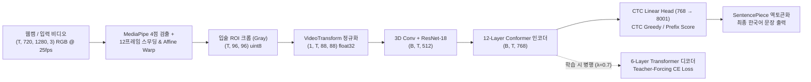

<div align="center">

# DOKDO: On-Device Korean Lip-Reading System via Two-Stage Transfer Learning

**전이학습 기반 온디바이스 한국어 립리딩 시스템의 실환경 검증**  
*(Real-World Validation of an On-Device Korean Lip-Reading System Based on Transfer Learning)*

[](https://huggingface.co/dlvusgks/dokdo-vsr)
[](https://www.python.org/)
[](https://pytorch.org/)
[](#)
[](LICENSE)

<br/>


<p align="center">
  <b>Figure 1.</b> Overall architecture of DOKDO: (Left) Asynchronous MAR-based Producer–Consumer webcam pipeline, (Center) 3D-CNN + ResNet-18 + 12-Layer Conformer visual backbone, and (Right) Two-stage transfer learning with Hybrid CTC + Attention CE loss and Korean SentencePiece Unigram (8,001 tokens).
</p>

</div>

---

### 🌐 Language Selection / 언어 선택
> 💡 **Click the toggle below to switch between the Korean and English documentation.**  
> 💡 **아래 토글 메뉴를 클릭하여 한국어 설명 또는 영어(English) 설명을 펼쳐 보실 수 있습니다.**

---

<details open>
<summary><h2>🇰🇷 한국어 문서 (Korean Documentation) — 클릭하여 접기/펼치기</h2></summary>

### 📑 목차 (Table of Contents)
1. [연구 개요 및 핵심 기여](#1-연구-개요-및-핵심-기여)
2. [베이스 모델(Auto-AVSR) 상속 부분 vs. DOKDO 자체 구현 비교](#2-베이스-모델auto-avsr-상속-부분-vs-dokdo-자체-구현-비교)
3. [모델 아키텍처 및 입출력 텐서 파이프라인](#3-모델-아키텍처-및-입출력-텐서-파이프라인)
4. [2단계 차등 학습률 전이학습 및 혼합 손실 함수](#4-2단계-차등-학습률-전이학습-및-혼합-손실-함수)
5. [정량적·정성적 실험 결과 (OLKAVS & KMSAV)](#5-정량적정성적-실험-결과-olkavs--kmsav)
6. [온디바이스 웹캠 실시간 파이프라인 및 6.61초 지연 측정 프로토콜](#6-온디바이스-웹캠-실시간-파이프라인-및-661초-지연-측정-프로토콜)
7. [저장소 디렉토리 구조 및 논문-코드 1:1 매핑표](#7-저장소-디렉토리-구조-및-논문-코드-11-매핑표)
8. [설치 및 단계별 전체 재현 명령어 (전처리 → 학습 → 평가 → 데모)](#8-설치-및-단계별-전체-재현-명령어-전처리--학습--평가--데모)

---

### 1. 연구 개요 및 핵심 기여

시각 음성 인식(Visual Speech Recognition, VSR)은 오디오 신호 없이 화자의 입술 움직임만으로 발화 내용을 텍스트로 복원하는 기술입니다. 기존 한국어 립리딩 선행 연구들은 대부분 고립 단어나 제한된 문장 분류에 머물러 있거나, 학습 코드·토크나이저·가중치 및 실환경 웹캠 파이프라인이 공개되지 않아 재현성에 한계가 있었습니다.

**DOKDO**는 대규모 영어 시각 음성 인식 모델([Auto-AVSR](https://github.com/mpc001/auto_avsr) / [Chaplin](https://github.com/amanvirparhar/chaplin))의 시각적 특징 추출 능력을 한국어로 전이(Transfer Learning)하고, 외부 클라우드 서버 없이 **단일 노트북(MacBook Pro M5 Pro CPU)의 내장 웹캠만으로 End-to-End 구동되는 온디바이스 한국어 립리딩 시스템**을 구현 및 검증하였습니다.

* **한국어 SentencePiece Unigram 8,001 어휘 체계 구축**: 교착어인 한국어의 어간·어미·조사 결합 특성을 반영하여 8,000개 서브워드 토큰 + CTC Blank(`id=8000`)로 구성된 총 8,001 차원 한국어 토크나이저 및 출력 헤드 구축
* **2단계 차등 학습률(Differential LR) 전이학습 및 도메인 적응**: 초기 5 에폭 백본 동결(Head Warm-up) 후 백본(`1e-5`)과 헤드(`1e-3`)에 100배 차등 학습률을 부여하는 2단계 전이학습 및 혼합 손실($0.3 L_{\text{CTC}} + 0.7 L_{\text{CE}}$)을 통해 OLKAVS Seen-speaker 테스트셋에서 **CER 22.90% / WER 41.36%** 달성 (동일 데이터셋 및 Visual-only 조건의 선행 연구 CER 37.27% 대비 **14.37%p 오류율 절감**)
* **온디바이스 실환경 웹캠 파이프라인 검증**: MediaPipe 기반 실시간 입술 ROI 정규화 및 MAR(Mouth Aspect Ratio) 자동 발화 감지와 비동기 Producer–Consumer 큐(`maxsize=4`)를 결합하여 상용 노트북 CPU에서 5.0초 발화 기준 평균 **6.61초** 내 로컬 추론 검증

---

### 2. 베이스 모델(Auto-AVSR) 상속 부분 vs. DOKDO 자체 구현 비교

본 연구에서 영어 사전학습 모델로부터 그대로 상속받은 부분과 한국어 전이 및 온디바이스 구동을 위해 자체 설계·구현한 범위는 아래 표와 같이 명확히 구분됩니다.

| 구분 모듈 | 출처 구분 | 파라미터 수 | 상세 구조 및 역할 | 관련 소스 파일 |
| :--- | :---: | :---: | :--- | :--- |
| **Visual Frontend** | 베이스 모델 상속<br>(LRS3 사전학습) | `~11.2M` | 3D Conv(`kernel=5x7x7`) + 2D ResNet-18 구조로 입술 ROI 프레임당 512차원 시공간 특징 추출 | `espnet/nets/pytorch_backend/backbones/` |
| **Conformer Encoder** | 베이스 모델 상속<br>(Phase 2 미세조정) | `~231.4M` | 12-Layer Conformer (`adim=768`, `aheads=12`, `eunits=3072`, Macaron FFN + MHSA + Conv `kernel=31`) | `espnet/nets/pytorch_backend/conformer/` |
| **한국어 토크나이저** | **DOKDO 자체 구축** | `8,001` 어휘 | 한국어 SentencePiece Unigram (`<unk>=0, <s>=1, </s>=2`, 서브워드 `3..7999`, `CTC blank=8000`) | `Train/train_tokenizer.py`<br>`Train/tokenizer_utils.py` |
| **출력 헤드 및 디코더 교체** | **DOKDO 자체 구현** | `~12.3M` | 영어 5,049 클래스 출력층을 제거하고 8,001 차원 한국어 `ctc.ctc_lo` 및 6-Layer Transformer Decoder 임베딩·출력층으로 교체 | `Train/model.py`<br>`pipelines/model_korean.py` |
| **2단계 차등 LR 전이학습** | **DOKDO 자체 구현** | 전체 `254.9M` | Phase 1(Epoch 1–5) 백본 동결 $\rightarrow$ Phase 2(Epoch 6–109) 차등 학습률(`1e-5` vs `1e-3`) + 혼합 손실($0.3 L_{\text{CTC}} + 0.7 L_{\text{CE}}$) 및 OLKAVS $\rightarrow$ KMSAV 순차 적응 | `Train/train.py`<br>`Train/plot_loss.py` |
| **온디바이스 웹캠 파이프라인** | **DOKDO 자체 구현** | — | MediaPipe 4점 검출·12프레임 스무딩·유사 변환 정렬·`96x96` $\rightarrow$ `88x88` 크롭 및 MAR 기반 비동기 생산자-소비자 큐(`Queue(maxsize=4)`) | `demo_webcam.py`<br>`util/lip_tracker_dokdo.py`<br>`pipelines/pipeline_korean.py` |

---

### 3. 모델 아키텍처 및 입출력 텐서 파이프라인



| 파이프라인 단계 | 텐서 Shape | 데이터 타입 | 핵심 연산 및 파라미터 |
| :--- | :---: | :---: | :--- |
| **1. 원본 비디오 프레임** | `(T, H, W, 3)` | `uint8` | `1280x720 @ 25fps` RGB 프레임 시퀀스 |
| **2. 입술 ROI 추출 (`VideoProcess`)** | `(T, 96, 96)` | `uint8` | MediaPipe 4점 검출 $\rightarrow$ 12프레임 이동 평균 스무딩 $\rightarrow$ LRS3 평균 얼굴(`256x256`) 유사 변환(Similarity Affine Warp) $\rightarrow$ 입 중심 `96x96` 그레이스케일 크롭 |
| **3. 텐서 변환 (`VideoTransform`)** | `(B, 1, T, 88, 88)` | `float32` | `/ 255.0` 스케일링 $\rightarrow$ `88x88` 크롭(학습: RandomCrop + HorizontalFlip(0.5) / 추론: CenterCrop) $\rightarrow$ `Normalize(mean=0.421, std=0.165)` |
| **4. 시공간 시각 프론트엔드** | `(B, T, 512)` | `float32` / `bf16` | 3D Conv(`5x7x7`, 시간 축 stride=1 보존) + 2D ResNet-18 |
| **5. Conformer 인코더** | `(B, T, 768)` | `float32` / `bf16` | 12개 Conformer 블록 (`adim=768`, `eunits=3072`, `aheads=12`, `cnn_kernel=31`) |
| **6. 한국어 출력층 & 디코딩** | `(B, T, 8001)` | `float32` | `ctc.ctc_lo` 선형 투영 $\rightarrow$ CTC Greedy($\arg\max \rightarrow$ 중복 병합 $\rightarrow$ `blank=8000` 제거) $\rightarrow$ SentencePiece 역토큰화 |

---

### 4. 2단계 차등 학습률 전이학습 및 혼합 손실 함수

#### 4.1 혼합 손실 함수 (Hybrid CTC + Attention Cross-Entropy Loss)
학습 과정(`Train/model.py`, `Train/train.py`)에서는 프레임 단위 단조 정렬(Monotonic Alignment)을 강제하는 CTC 손실과 한국어 문맥 의존성을 학습하는 Transformer 디코더의 교차 엔트로피 손실(Label Smoothing `0.1` 적용)을 결합하여 최적화합니다:

$$L = \lambda L_{\text{CTC}} + (1 - \lambda) L_{\text{CE}}, \quad \lambda = 0.3$$

* **학습 경로 vs. 온디바이스 추론 경로의 구분**:
  * **학습 시**: Conformer 인코더 위의 CTC 분기($\lambda=0.3$)와 6-Layer Transformer 디코더 분기($1-\lambda=0.7$, Teacher-Forcing `sos_id=1, eos_id=2`)를 모두 활성화하여 인코더가 한국어 어순 및 문맥 정보를 풍부하게 내재화하도록 유도합니다.
  * **온디바이스 추론 시 (`decode=ctc`, 논문 기본값)**: 자기회귀(Autoregressive) 반복 연산으로 인해 CPU 지연의 병목이 되는 Transformer 디코더를 생략하고, **Visual Frontend + Conformer 인코더 + CTC 선형 헤드(`ctc.ctc_lo`)의 CTC Greedy 디코딩**만 수행하여 실시간에 준하는 응답 속도를 확보합니다. (정확도 우선 시 `--decode hybrid`로 Joint CTC/Attention Beam Search도 선택 가능)

#### 4.2 2단계 전이학습 스케줄 및 수렴 곡선

<div align="center">
  
  <p align="center"><b>Figure 2.</b> OLKAVS 2단계 전이학습(Phase 1 동결 워밍업 → Phase 2 차등 학습률 미세조정) 및 KMSAV 도메인 적응 손실 수렴 곡선.</p>
</div>

| 학습 단계 | 에폭 구간 | 학습 대상 모듈 | 동결(Freeze) 모듈 | 학습률 (`AdamW`, `wd=0.01`) | 단계별 목적 및 동작 |
| :--- | :---: | :--- | :--- | :---: | :--- |
| **Phase 1<br>(Head Warm-up)** | **Epoch 1 – 5** | 한국어 CTC 헤드 + 디코더<br>(`12.3M` 파라미터) | Visual Frontend + Conformer 인코더 (`242.6M` 파라미터) | `LR_HEAD = 1e-3`<br>(3 에폭 선형 워밍업 + Cosine) | 무작위 초기화된 8,001 클래스 한국어 헤드에서 발생하는 초기 큰 그래디언트가 사전학습된 시각 백본을 훼손하는 현상 방지 |
| **Phase 2<br>(Full Fine-Tuning)** | **Epoch 6 – 109** | **전체 네트워크**<br>(`254.9M` 파라미터) | 없음 (전체 해동) | `LR_ENCODER = 1e-5`<br>`LR_HEAD = 1e-3`<br>(CosineAnnealingLR) | 백본에 헤드 대비 1/100 수준의 미세 학습률을 부여하여 파괴적 망각(Catastrophic Forgetting) 없이 한국어 입모양 조음 패턴에 적응 |
| **Stage 2 도메인 적응<br>(OLKAVS $\rightarrow$ KMSAV)** | 순차 파인튜닝 | 전체 네트워크 | Phase 1 $\rightarrow$ 2 동일 적용 | `--pretrained_kr_ckpt`로 OLKAVS 최적 가중치 로드 | 통제된 스튜디오 데이터(OLKAVS, ~1.5TB)로 학습된 모델을 야생 유튜브 환경(KMSAV, ~100GB)으로 순차 도메인 적응 |

---

### 5. 정량적·정성적 실험 결과 (OLKAVS & KMSAV)

#### 5.1 정량적 성능 비교 (논문 표 1)

> 📌 **'자연발화(Natural Sentence Utterance)' 용어의 정의**: 본 논문과 표 1에서 기술하는 '자연발화'는 비계획적 자유 대화(Unscripted Spontaneous Conversation)가 아니라, **초기 한국어 립리딩 연구의 '고립 단어/숫자 분류'와 대비되는 개념으로서 일상 어휘와 조사·어미가 결합된 '다어절 연속 문장 발화(Continuous Multi-Word Sentence Utterances)'** 를 의미합니다.

| 모델 / 연구 | 입력 모달리티 | 백본 및 디코딩 구조 | 평가 데이터셋 | 분할 조건 | WER (%) | CER (%) | 코드·가중치 공개 | 온디바이스 웹캠 E2E |
| :--- | :---: | :--- | :--- | :---: | :---: | :---: | :---: | :---: |
| **Cho & Yoon (2024)** | Visual-only | 3D-CNN + ResNet-18 + Transformer (CTC) | AI Hub (OLKAVS) | Seen-speaker | — | 37.27 | 미공개 | 미구현 |
| **KM-AVSR (2025)** | Audio + Visual | Multimodal Backbone + LLM | AI Hub (OLKAVS) | Seen-speaker | — | 15.66 | 미공개 | 미구현 |
| **DOKDO (Ours)** | **Visual-only** | **Auto-AVSR Conformer + SentencePiece (8,001)** | **OLKAVS (~1.5 TB)** | **Seen-speaker** | **41.36** | **22.90** | **공개** | **구현 및 실환경 검증** |
| **DOKDO (Ours)** | **Visual-only** | **Auto-AVSR Conformer + SentencePiece (8,001)** | **OLKAVS (~1.5 TB)** | **Unseen-speaker** | 89.55 | 72.70 | **공개** | **구현 및 실환경 검증** |
| **DOKDO (Ours)** | **Visual-only** | **Auto-AVSR Conformer + SentencePiece (8,001)** | **KMSAV (~100 GB)** | **In-the-wild (YouTube)** | 99.47 | 95.83 | **공개** | **구현 및 실환경 검증** |

#### 5.2 정성적 추론 예시 및 한국어 독순 오류 유형 분석 (리뷰어 코멘트 #5 반영)

실제 테스트셋 및 웹캠 시연에서 확인된 대표적인 추론 사례와 시각적 모호성(Homophene)에 따른 오류 양상은 다음과 같습니다:

| 분석 유형 | 정답 문장 (Ground Truth, `REF`) | 모델 예측 문장 (Prediction, `PRED`) | 시각적·언어학적 분석 |
| :--- | :--- | :--- | :--- |
| **웹캠 실시간 시연<br>(논문 그림 2)** | `요즘 연애를 하고 싶은데 일상이 바빠서 할 수가 없어.` | `요즘 연애 하고 싶은데 일상 바빠서 할수` | 문장의 핵심 내용어(`요즘`, `연애`, `하고 싶은데`, `일상`, `바빠서`, `할수`)는 정확히 복원되었으나, 입술 개구도가 작고 발화 지속 시간이 짧은 조사(`를`, `이`)와 문미 종결 구간(`가 없어`)이 탈락함 |
| **완전 일치 사례<br>(OLKAVS Test)** | `오늘 응급실에 다녀왔어.`<br>`병원에 가기 귀찮아.`<br>`건강검진 빨리해야겠다.`<br>`사랑하는 사람과 곧 결혼하게 돼서 기뻐.` | `오늘 응급실에 다녀왔어.`<br>`병원에 가기 귀찮아.`<br>`건강검진 빨리해야겠다.`<br>`사랑하 사람과 곧 결혼하 돼서 기뻐.` | 양순음(`ㅁ, ㅂ, ㅍ`)과 원순모음(`ㅗ, ㅜ`) 등 입술 윤곽 변화가 뚜렷한 일상 문장에서 높은 어절·음절 복원율을 보임 |
| **동형 구형(Homophene) 및 어미 변이 사례** | `어머니가 치매라서 요양원을 알아봐야 해서 혼란스러워.`<br>`건강이 안 좋으니 비통함이 느껴져.` | `어머니 치매라 요양원 알아봐야 해서 혼란스러워.`<br>`건강이 안 좋으니 비통함 느껴져.` | 입모양만으로 구분하기 어려운 연구개음·치조음 받침이나 연음 구간에서 조사(`가`, `을`, `이`)가 생략되나 전체 문장 의미는 보존됨 |

---

### 6. 온디바이스 웹캠 실시간 파이프라인 및 6.61초 지연 측정 프로토콜

<div align="center">
  
  <p align="center"><b>Figure 3.</b> MacBook Pro (M5 Pro, CPU) 단일 디바이스 환경에서의 실시간 웹캠 추론 및 한글 자막 오버레이 화면 (논문 그림 2).</p>
</div>

#### 6.1 웹캠 실행 모드 2종 (`demo_webcam.py`)
1. **수동 측정 모드 (`python demo_webcam.py --mode manual`, 기본값 — 논문 표 2 벤치마크 기준)**
   * 사용자가 `SPACE` 키를 눌러 발화 녹화를 시작하고, 발화가 끝나면 다시 `SPACE` 키를 눌러 종료합니다.
   * 녹화가 끝난 직후 전처리(`t_preprocess`)와 VSR 모델 추론(`t_infer`)이 순차 실행되며, **녹화 시간을 제외한 순수 처리 지연 시간**이 단계별로 콘솔과 `result_korean.txt`에 출력됩니다.
2. **비동기 MAR 자동 감지 큐 모드 (`python demo_webcam.py --mode async` — 논문 그림 1 아키텍처 기준)**
   * **Producer 스레드 (`util/lip_tracker_dokdo.py`)**:
     1. **3초 정면 폐구 캘리브레이션**: 초기 3초간 입을 다문 정면 상태에서 사용자별 3D MAR 평균을 측정하여 개인화된 개구 임계값(`OPEN_THRESHOLD = mean(MAR) + 0.04`)을 자동 설정합니다.
     2. **15프레임 프리롤 버퍼(`deque(maxlen=15)`)**: 입이 벌어지기 직전 15프레임을 상시 링버퍼에 보존하여 발화 시작 시 병합함으로써 어두 초성 입모양 유실을 방지합니다.
     3. **1.0초 무음 종료 및 2단계 프레임 검증**: 1.0초 이상 입이 다물어지면 발화 종료로 판정하고, 전체 프레임(`>20`) 및 유효 MAR 프레임(`>=5`) 조건을 통과한 경우에만 `VideoProcess`를 거쳐 `(T, 96, 96)` `uint8` 텐서를 생성합니다.
     4. **비동기 큐 적재 (`queue.Queue(maxsize=4)`)**: 큐가 가득 찬 경우 가장 오래된 발화 항목을 제거(Oldest-drop)하고 최신 발화를 삽입하여 카메라 캡처 루프가 멈추지 않도록 보장합니다.
   * **Consumer 스레드 (`demo_webcam.py`)**: 백그라운드에서 큐의 `(T, 96, 96)` 텐서를 꺼내 `88x88` 정규화 및 `KoreanAVSR.infer()`를 수행하고, 인식된 한국어 자막을 실시간 카메라 프리뷰 하단에 렌더링합니다.

#### 6.2 평균 5.0초 발화 $\rightarrow$ 6.61초 처리 시간 측정 프로토콜 (논문 표 2 및 III.3절)

| 측정 항목 | 상세 사양 및 기준 |
| :--- | :--- |
| **측정 하드웨어** | Apple MacBook Pro (M5 Pro, 48 GB Unified Memory) |
| **연산 백엔드** | CPU 단독 구동 (`15-core ARM64`, `device="cpu"`, FP32) |
| **카메라 입력 사양** | `1280 x 720 @ 25 fps` |
| **기준 발화 길이** | 평균 **5.0초** (`~125 frames @ 25fps`, 예: *"요즘 연애를 하고 싶은데 일상이 바빠서 할 수가 없어."*) |
| **측정 시작/종료 시점 정의** | **화자가 말을 하는 녹화 시간(5.0초)은 처리 지연 시간에서 제외함.**<br>• $t_0$: 발화 녹화 종료 시점<br>• $t_1$: MediaPipe 4점 랜드마크 추출 + 12프레임 스무딩 + Affine 정렬 + `96x96` $\rightarrow$ `88x88` 정규화 완료 시점 (`t_preprocess` $= t_1 - t_0$)<br>• $t_2$: Conformer 인코더 + CTC Greedy 디코딩 + SentencePiece 역토큰화 완료 시점 (`t_infer` $= t_2 - t_1$)<br>• **총 처리 시간 (`t_total`)**: $t_2 - t_0 = t_{\text{preprocess}} + t_{\text{infer}}$ |
| **평균 총 처리 시간** | **6.61초** (실시간 계수 $\text{RTF} = 6.61 / 5.0 \approx 1.32$) |

---

### 7. 저장소 디렉토리 구조 및 논문-코드 1:1 매핑표

```text
DOKDO-VSR/
├── README.md                        # 한국어 / 영어 통합 문서 (토글 지원)
├── requirements.txt                 # 전체 실행 환경 패키지 목록
├── demo_webcam.py                   # 온디바이스 웹캠 데모 (--mode manual | --mode async)
├── configs/
│   └── korean.ini                   # 한국어 추론 설정 (model_path, spm_model, decode=ctc|hybrid)
├── util/
│   └── lip_tracker_dokdo.py         # 비동기 MAR 자동 발화 감지 Producer 및 Queue(maxsize=4) 관리
├── pipelines/
│   ├── pipeline_korean.py           # 한국어 E2E 추론 파이프라인 (forward & forward_with_timing)
│   ├── model_korean.py              # KoreanAVSR 래퍼 (CTC Greedy 및 KoreanCTCPrefixScorer 빔 서치)
│   ├── data/
│   │   ├── data_module.py           # 비디오 로드 및 전처리 연결 모듈
│   │   └── transforms.py            # VideoTransform (88x88 크롭 및 Normalize(0.421, 0.165))
│   └── detectors/mediapipe/
│       ├── detector.py              # MediaPipe 4-keypoint 얼굴 랜드마크 검출기
│       └── video_process.py         # 12프레임 윈도우 스무딩, Similarity Affine Warp, 96x96 크롭
├── Train/
│   ├── preprocess.py                # 원본 MP4 + AI Hub JSON -> 문장 단위 (T, 96, 96) .npz 변환 (8:1:1 분할)
│   ├── train_tokenizer.py           # 한국어 SentencePiece Unigram (8,000 어휘) 토크나이저 학습 스크립트
│   ├── tokenizer_utils.py           # KoreanTokenizer 래퍼 (vocab_size=8,001, blank_id=8000)
│   ├── dataset.py                   # KoreanVSRDataset 및 가변 길이 패딩 collate_fn
│   ├── model.py                     # KoreanVSRModel (8,001 헤드 교체 및 Hybrid CTC + Decoder CE 손실)
│   ├── train.py                     # 2단계 차등 학습률 전이학습 및 KMSAV 도메인 적응 스크립트
│   ├── evaluate.py                  # CER(음절 편집거리) 및 WER(어절 편집거리) 정량 평가 스크립트
│   └── plot_loss.py                 # 2단계 전이학습 손실 수렴 곡선 시각화 스크립트
├── benchmarks/LRS3/models/
│   └── LRS3_V_WER19.1/model.json    # Auto-AVSR Conformer 백본 하이퍼파라미터 설정
└── assets/
    ├── pipeline.jpeg                # 논문 그림 1 (전체 시스템 아키텍처)
    ├── result.jpeg                  # 논문 그림 2 (실시간 웹캠 시연 화면)
    └── training_curve.svg           # 2단계 전이학습 및 KMSAV 적응 손실 수렴 곡선
```

---

### 8. 설치 및 단계별 전체 재현 명령어 (전처리 → 학습 → 평가 → 데모)

#### Step 1. 가상환경 생성 및 패키지 설치
```bash
git clone https://github.com/sangdeok-EE/DOKDO-VSR.git
cd DOKDO-VSR

conda create -n dokdo-vsr python=3.10 -y
conda activate dokdo-vsr
pip install -r requirements.txt
```

#### Step 2. 사전학습 가중치 다운로드 및 토크나이저 준비
1. **한국어 VSR 모델 가중치 (`korean_vsr_hybrid.pt`)**:  
   [HuggingFace (`dlvusgks/dokdo-vsr`)](https://huggingface.co/dlvusgks/dokdo-vsr)에서 `korean_vsr_hybrid.pt`를 다운로드하여 저장소 루트(`DOKDO-VSR/korean_vsr_hybrid.pt`)에 배치합니다.
2. **한국어 SentencePiece 토크나이저 (`pipelines/tokens/unigram8000.model`)**:
   > ⚠️ **라이선스 안내**: 토크나이저 어휘 사전은 AI Hub 한국어 립리딩 데이터셋(OLKAVS / KMSAV)의 전사 텍스트로부터 유도되었으므로, AI Hub 데이터 재배포 정책에 따라 바이너리 파일(`.model`)을 GitHub에 직접 커밋하지 않았습니다.
   * 기존 `unigram8000.model` 파일을 보유하신 경우 `pipelines/tokens/unigram8000.model` 경로에 배치합니다.
   * AI Hub 데이터셋(JSON 라벨 또는 전처리된 `.npz`)에서 직접 생성하려면 아래 명령어를 실행합니다:
     ```bash
     python Train/train_tokenizer.py \
         --json_dir /path/to/OLKAVS/json_labels \
         --output_prefix pipelines/tokens/unigram8000 \
         --vocab_size 8000
     ```

#### Step 3. 데이터 전처리 (`MP4 + JSON` $\rightarrow$ `.npz`)
```bash
python Train/preprocess.py \
    --data_root /path/to/raw_videos \
    --json_root /path/to/json_labels \
    --output_dir data/preprocessed \
    --detector mediapipe \
    --train_ratio 0.8 --val_ratio 0.1 --seed 42
```

#### Step 4. 2단계 차등 학습률 전이학습 (OLKAVS 1차 학습 $\rightarrow$ KMSAV 2차 적응)
```bash
# [Stage 1] OLKAVS 2단계 전이학습 (Phase 1: 5 에폭 백본 동결 -> Phase 2: 차등 학습률 1e-5 / 1e-3, 혼합 손실 0.3 CTC + 0.7 CE)
python Train/train.py \
    --train_dir data/preprocessed/train \
    --val_dir data/preprocessed/validation \
    --test_dir data/preprocessed/test \
    --chaplin_checkpoint benchmarks/LRS3/models/LRS3_V_WER19.1/model.pth \
    --model_conf benchmarks/LRS3/models/LRS3_V_WER19.1/model.json \
    --spm_model pipelines/tokens/unigram8000.model \
    --output_dir Train/output_olkavs \
    --loss_type hybrid --ctc_weight 0.3 \
    --freeze_epochs 5 --lr_encoder 1e-5 --lr_head 1e-3 \
    --epochs 109 --batch_size 8 --grad_accum 2

# [Stage 2] KMSAV 야생(YouTube) 도메인 적응 파인튜닝 (OLKAVS 최적 체크포인트에서 이어서 학습)
python Train/train.py \
    --train_dir data/kmsav_preprocessed/train \
    --val_dir data/kmsav_preprocessed/validation \
    --pretrained_kr_ckpt Train/output_olkavs/checkpoints/best_model.pt \
    --model_conf benchmarks/LRS3/models/LRS3_V_WER19.1/model.json \
    --spm_model pipelines/tokens/unigram8000.model \
    --output_dir Train/output_kmsav \
    --loss_type hybrid --ctc_weight 0.3 \
    --freeze_epochs 5 --lr_encoder 1e-5 --lr_head 1e-3
```

#### Step 5. 정량적 성능 평가 (CER & WER — 논문 표 1 재현)
```bash
# 1) 논문 기본 추론 경로: CTC Greedy 디코딩 평가
python Train/evaluate.py \
    --test_dir data/preprocessed/test \
    --checkpoint korean_vsr_hybrid.pt \
    --spm_model pipelines/tokens/unigram8000.model \
    --decode ctc \
    --output_file eval_result_ctc.txt

# 2) 하이브리드 추론 경로: Joint CTC/Attention Beam Search 평가
python Train/evaluate.py \
    --test_dir data/preprocessed/test \
    --checkpoint korean_vsr_hybrid.pt \
    --spm_model pipelines/tokens/unigram8000.model \
    --decode hybrid --ctc_weight 0.3 --beam_size 10 \
    --output_file eval_result_hybrid.txt
```

#### Step 6. 온디바이스 실시간 웹캠 데모 실행 (논문 그림 1, 그림 2, 표 2 재현)
```bash
# 모드 A: 수동 SPACE바 녹화 및 단계별 지연 시간(6.61초) 측정 모드 (논문 표 2)
python demo_webcam.py --mode manual --decode ctc

# 모드 B: MAR 기반 자동 발화 감지 + 비동기 Producer-Consumer 큐 모드 (논문 그림 1)
python demo_webcam.py --mode async --decode ctc
```

</details>

---

<details>
<summary><h2>🇺🇸 English Documentation — Click to Expand / Collapse</h2></summary>

### 📑 Table of Contents
1. [Overview & Key Contributions](#1-overview--key-contributions)
2. [Inherited Backbone vs. DOKDO Korean Adaptations](#2-inherited-backbone-vs-dokdo-korean-adaptations)
3. [Two-Stage Transfer Learning & Hybrid Objective](#3-two-stage-transfer-learning--hybrid-objective)
4. [Quantitative & Qualitative Results](#4-quantitative--qualitative-results)
5. [On-Device Webcam Pipeline & Latency Protocol](#5-on-device-webcam-pipeline--latency-protocol)
6. [Paper-to-Code File Mapping](#6-paper-to-code-file-mapping)
7. [Setup & End-to-End Reproducible Commands](#7-setup--end-to-end-reproducible-commands)

---

### 1. Overview & Key Contributions

**DOKDO** is an end-to-end on-device Korean Visual Speech Recognition (VSR) system that transfers spatiotemporal visual representations from an English LRS3-pretrained backbone ([Auto-AVSR](https://github.com/mpc001/auto_avsr) / [Chaplin](https://github.com/amanvirparhar/chaplin)) to Korean and validates real-time execution on a single consumer laptop with a built-in webcam.

* **Korean SentencePiece Unigram Vocabulary (`8,001` tokens)**: Replaces the 5,049-unit English output layer with an 8,000-subword Korean Unigram vocabulary plus a dedicated CTC blank token (`id=8000`) to handle Korean agglutinative morphology.
* **Two-Stage Differential-LR Transfer Learning**: Combines a 5-epoch head warm-up stage (backbone frozen) with full fine-tuning using differential learning rates (`1e-5` for the Conformer backbone vs. `1e-3` for the Korean head/decoder) under a Hybrid CTC/CE objective ($L = 0.3 L_{\text{CTC}} + 0.7 L_{\text{CE}}$), achieving **22.90% CER and 41.36% WER** on the OLKAVS Seen-speaker benchmark (reducing CER by **14.37%p** compared to prior visual-only Korean VSR work).
* **On-Device Asynchronous Webcam Pipeline**: Integrates MediaPipe 4-keypoint affine ROI normalization with a 3D Mouth Aspect Ratio (MAR) utterance detector and an asynchronous Producer–Consumer queue (`maxsize=4`), achieving **6.61 s** average processing time per 5.0 s utterance on an Apple M5 Pro CPU without external server communication.

---

### 2. Inherited Backbone vs. DOKDO Korean Adaptations

| Component | Origin | Parameters | Specification & Role | Source Files |
| :--- | :---: | :---: | :--- | :--- |
| **Visual Frontend** | Inherited (LRS3 Pretrained) | `~11.2M` | 3D Conv (`5x7x7`) + 2D ResNet-18 extracting 512-D visual features per frame | `espnet/nets/pytorch_backend/backbones/` |
| **Conformer Encoder** | Inherited (Fine-tuned in Phase 2) | `~231.4M` | 12-Layer Conformer (`adim=768`, `aheads=12`, `eunits=3072`, Conv `kernel=31`) | `espnet/nets/pytorch_backend/conformer/` |
| **Korean Tokenizer** | **DOKDO (Ours)** | `8,001` vocab | Korean SentencePiece Unigram (`<unk>=0, <s>=1, </s>=2`, pieces `3..7999`, `CTC blank=8000`) | `Train/train_tokenizer.py`<br>`Train/tokenizer_utils.py` |
| **Output Heads** | **DOKDO (Ours)** | `~12.3M` | Replaced 5,049-unit English head/decoder with 8,001-unit Korean `ctc.ctc_lo` and 6-layer Transformer Decoder | `Train/model.py`<br>`pipelines/model_korean.py` |
| **2-Stage Transfer Learning** | **DOKDO (Ours)** | `254.9M` total | Phase 1 (Epochs 1–5) backbone freeze $\rightarrow$ Phase 2 (Epochs 6–109) differential LR (`1e-5` / `1e-3`) + Hybrid loss ($0.3 L_{\text{CTC}} + 0.7 L_{\text{CE}}$) | `Train/train.py`<br>`Train/plot_loss.py` |
| **On-Device Webcam Pipeline** | **DOKDO (Ours)** | — | MediaPipe 4-keypoint affine ROI crop (`96x96` $\rightarrow$ `88x88`) + Manual E2E & Async MAR Producer–Consumer Queue | `demo_webcam.py`<br>`util/lip_tracker_dokdo.py`<br>`pipelines/pipeline_korean.py` |

---

### 3. Two-Stage Transfer Learning & Hybrid Objective

$$L = \lambda L_{\text{CTC}} + (1 - \lambda) L_{\text{CE}}, \quad \lambda = 0.3$$

* **Training vs. Inference Decoding**:
  * **Training (`Train/model.py`, `Train/train.py`)**: Jointly optimizes the CTC head ($\lambda = 0.3$) and the 6-layer Transformer Decoder ($1 - \lambda = 0.7$, label smoothing `0.1`, teacher forcing) so the Conformer encoder learns both frame-level lip alignment and Korean linguistic context.
  * **On-Device Inference (`pipelines/model_korean.py`)**: Defaults to **`decode=ctc`** (CTC Greedy decoding + SentencePiece detokenization), bypassing the autoregressive Transformer Decoder to minimize CPU latency on edge devices. Joint CTC/Attention beam search remains available via `--decode hybrid`.

| Phase | Epochs | Visual Frontend + Conformer | Korean CTC Head & Decoder | Learning Rate (`AdamW`, `wd=0.01`) | Objective |
| :--- | :---: | :---: | :---: | :---: | :--- |
| **Phase 1 (Head Warm-up)** | Epoch 1 – 5 | **Frozen** (`242.6M`) | **Trainable** (`12.3M`) | `lr_head = 1e-3` (3-ep warmup + Cosine) | Stabilize randomly initialized Korean head without distorting pretrained visual weights |
| **Phase 2 (Full Fine-Tuning)** | Epoch 6 – 109 | **Trainable** | **Trainable** | `lr_encoder = 1e-5`, `lr_head = 1e-3` (Cosine) | Adapt visual features to Korean lip articulation while preventing catastrophic forgetting |

---

### 4. Quantitative & Qualitative Results

| Study | Modality | Backbone & Decoding | Dataset | Split | WER (%) | CER (%) | Open-Source / Webcam E2E |
| :--- | :---: | :--- | :--- | :---: | :---: | :---: | :---: |
| **Cho & Yoon (2024)** | Visual-only | 3D-CNN + ResNet-18 + Transformer (CTC) | AI Hub (OLKAVS) | Seen-speaker | — | 37.27 | No |
| **KM-AVSR (2025)** | Audio + Visual | Multimodal Backbone + LLM | AI Hub (OLKAVS) | Seen-speaker | — | 15.66 | No |
| **DOKDO (Ours)** | **Visual-only** | **Auto-AVSR Conformer + SentencePiece (8,001)** | **OLKAVS (~1.5 TB)** | **Seen-speaker** | **41.36** | **22.90** | **Yes (Weights + Code + Webcam E2E)** |
| **DOKDO (Ours)** | **Visual-only** | **Auto-AVSR Conformer + SentencePiece (8,001)** | **OLKAVS (~1.5 TB)** | **Unseen-speaker** | 89.55 | 72.70 | **Yes** |
| **DOKDO (Ours)** | **Visual-only** | **Auto-AVSR Conformer + SentencePiece (8,001)** | **KMSAV (~100 GB)** | **In-the-wild (YouTube)** | 99.47 | 95.83 | **Yes** |

> **Note on "Natural Sentence Utterances (자연발화)"**: In our paper, *natural utterance* refers to continuous multi-word sentence-level speech (as opposed to isolated word/digit classification in earlier Korean lip-reading studies), rather than unscripted spontaneous conversation.

---

### 5. On-Device Webcam Pipeline & Latency Protocol

* **Hardware & Backend**: MacBook Pro (Apple M5 Pro, 48 GB RAM), 15-core ARM64 CPU (`device="cpu"`, FP32), `1280x720 @ 25fps`.
* **Preprocessing Sequence**: MediaPipe 4-keypoint detection $\rightarrow$ 12-frame moving-average smoothing $\rightarrow$ 2D similarity affine warp to LRS3 mean face (`256x256`) $\rightarrow$ `96x96` grayscale mouth crop $\rightarrow$ `88x88` crop & `Normalize(0.421, 0.165)`.
* **Latency Measurement Boundary (`6.61 s` per `5.0 s` utterance)**: **Video recording duration is excluded.** Processing latency is measured from the end of utterance capture ($t_0$), through MediaPipe ROI preprocessing ($t_1$, `t_preprocess`), to final Korean text output ($t_2$, `t_infer`), yielding $t_{\text{total}} = t_{\text{preprocess}} + t_{\text{infer}} = 6.61\text{ s}$ ($\text{RTF} \approx 1.32$).
* **Figure 2 Demo Example**:
  * **GT**: `"요즘 연애를 하고 싶은데 일상이 바빠서 할 수가 없어."`
  * **PRED**: `"요즘 연애 하고 싶은데 일상 바빠서 할수"` (Core content words preserved; short grammatical particles `를/이` and sentence-final `가 없어` omitted due to subtle mouth opening).

---

### 6. Paper-to-Code File Mapping

| File Path | Paper Section / Figure | Description |
| :--- | :---: | :--- |
| `demo_webcam.py` | Sec. II.4, III.3, Fig. 1, Fig. 2, Table 2 | On-device webcam demo supporting `--mode manual` (SPACEbar E2E with latency breakdown) and `--mode async` (MAR Producer–Consumer queue) |
| `util/lip_tracker_dokdo.py` | Sec. II.4, Fig. 1 | Real-time MAR utterance detector (3s calibration, 15-frame pre-roll, 1.0s silence trigger, `(T, 96, 96)` ROI enqueue with oldest-drop) |
| `pipelines/pipeline_korean.py` | Sec. II.1, III.3 | End-to-end inference pipeline (`forward` & `forward_with_timing`) |
| `pipelines/model_korean.py` | Sec. II.2, II.3 | `KoreanAVSR` inference wrapper (`decode=ctc` and `decode=hybrid`) |
| `Train/preprocess.py` | Sec. II.1, III.1 | Raw MP4 + AI Hub JSON $\rightarrow$ per-sentence `(T, 96, 96)` `.npz` generator (`8:1:1` video-level split) |
| `Train/train_tokenizer.py` | Sec. II.2 | Trains the 8,000-piece Korean SentencePiece Unigram model (`unigram8000.model`) |
| `Train/model.py` | Sec. II.2, II.3, Fig. 1 | `KoreanVSRModel` (8,001 head replacement + Hybrid CTC/CE loss) |
| `Train/train.py` | Sec. II.3, III.1, Fig. 1 | Two-stage differential-LR training script (`freeze_epochs=5`, `lr_encoder=1e-5`, `lr_head=1e-3`, `ctc_weight=0.3`) |
| `Train/evaluate.py` | Sec. III.2, Table 1 | Computes micro-averaged CER and WER on `.npz` test sets or TSV manifests |
| `Train/plot_loss.py` | Sec. III.1 | Plots two-stage transfer learning and domain adaptation loss curves |

---

### 7. Setup & End-to-End Reproducible Commands

```bash
# 1. Install dependencies
conda create -n dokdo-vsr python=3.10 -y
conda activate dokdo-vsr
pip install -r requirements.txt

# 2. Train or place SentencePiece tokenizer (pipelines/tokens/unigram8000.model)
python Train/train_tokenizer.py --json_dir /path/to/OLKAVS/json_labels --output_prefix pipelines/tokens/unigram8000

# 3. Preprocess raw MP4 + JSON into per-sentence .npz clips
python Train/preprocess.py --data_root /path/to/raw_videos --json_root /path/to/json_labels --output_dir data/preprocessed --detector mediapipe

# 4. Run 2-Stage Transfer Learning (OLKAVS -> KMSAV)
python Train/train.py --train_dir data/preprocessed/train --val_dir data/preprocessed/validation --loss_type hybrid --ctc_weight 0.3 --freeze_epochs 5 --lr_encoder 1e-5 --lr_head 1e-3 --epochs 109

# 5. Evaluate CER & WER
python Train/evaluate.py --test_dir data/preprocessed/test --checkpoint korean_vsr_hybrid.pt --spm_model pipelines/tokens/unigram8000.model --decode ctc

# 6. Run On-Device Webcam Demo (Manual Benchmark Mode or Async MAR Queue Mode)
python demo_webcam.py --mode manual --decode ctc
python demo_webcam.py --mode async --decode ctc
```

</details>

---

## 📖 Citation (BibTeX)

If you find this repository or our paper useful in your research, please consider citing:

```bibtex
@article{dokdo2026koreanvsr,
  title   = {DOKDO: Real-World Validation of an On-Device Korean Lip-Reading System Based on Transfer Learning (전이학습 기반 온디바이스 한국어 립리딩 시스템의 실환경 검증)},
  author  = {Kim, Sangdeok and Collaborators},
  journal = {Journal of the Institute of Electronics and Information Engineers (전자공학회논문지)},
  year    = {2026}
}
```

## 🙏 Acknowledgments & License

* Built upon [Auto-AVSR](https://github.com/mpc001/auto_avsr) and [Chaplin](https://github.com/amanvirparhar/chaplin) (Imperial College London) with [ESPnet](https://github.com/espnet/espnet).
* Korean lip-reading datasets (**OLKAVS**, **KMSAV**) were provided by [AI Hub](https://www.aihub.or.kr/).
* Licensed under the [Apache-2.0 License](LICENSE).
