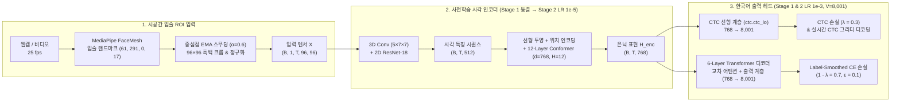

<div align="center">

<h1>DOKDO-VSR: 한국어 시각적 음성인식 및 온디바이스 실시간 입술 독순 시스템</h1>
<p><b>Conformer 인코더 기반 시각적 특징 전이학습과 CTC-Attention 혼합 손실을 활용한 한국어 독순(Lip-Reading) 모델</b></p>

<p>
  
  
  
  
  
</p>

<h3>
  <a href="README.md"><b>🇺🇸 English</b></a> &nbsp;|&nbsp; <b>🇰🇷 한국어 (Korean)</b>
</h3>

<p>
  <a href="#1-연구-개요-및-핵심-기여">개요 및 기여</a> •
  <a href="#2-베이스-모델-상속-구조-vs-dokdo-자체-구현-비교">베이스 모델 비교</a> •
  <a href="#3-모델-아키텍처-및-입출력-텐서-파이프라인">모델 아키텍처</a> •
  <a href="#4-2단계-차등-학습률-전이학습-및-혼합-손실-함수">전이학습 및 수렴</a> •
  <a href="#5-정량적정성적-실험-결과-및-독순-오류-분석">실험 결과</a> •
  <a href="#6-온디바이스-웹캠-실시간-파이프라인-및-661초-측정-프로토콜">웹캠 데모</a> •
  <a href="#7-디렉토리-구조-및-논문-코드-매핑">코드 매핑</a> •
  <a href="#8-설치-및-단계별-재현-명령어">재현 방법</a>
</p>

</div>

---

## 1. 연구 개요 및 핵심 기여

**시각적 음성인식(Visual Speech Recognition, VSR)** 또는 **입술 독순(Lip-Reading)**은 오디오 신호 없이 화자의 입술 움직임만으로 발화 내용을 텍스트로 변환하는 기술로, 고소음 환경의 음성 인식 보조, 보안·군사 통신, 청각·발화 장애인의 의사소통 지원 등 다양한 응용 가능성을 지닌다. 그러나 기존 VSR 연구는 LRS2, LRS3, VoxCeleb2 등 대규모 영어 데이터셋과 영어 알파벳·단어 단위 토크나이저에 편중되어 있으며, 교착어이자 음절 단위로 조합되는 한국어 VSR의 공개 베이스라인 및 학습·추론 파이프라인은 극히 부족하다.

**DOKDO-VSR**은 대규모 다국어 데이터로 사전학습된 시각적 음성 표현 모델([Visual Speech Recognition for Multiple Languages, Ma et al., 2022](https://github.com/mpc001/Visual_Speech_Recognition_for_Multiple_Languages) / [Chaplin](https://github.com/amanvirparhar/chaplin))의 시각적 시공간 인코더를 한국어 발화 도메인으로 전이학습하고, 별도의 외부 언어 모델(LM)이나 클라우드 API 없이 노트북 단일 환경에서 동작하는 **온디바이스 실시간 한국어 독순 시스템**을 제안한다.

### 주요 기여 (Key Contributions)
1. **한국어 전용 8,000 어휘 SentencePiece Unigram 토크나이저 설계**: 한국어 형태소·음절 결합 특성을 반영하고 다국어 사전학습 출력층 대비 파라미터를 절감하면서도 미등록 단어(OOV) 문제를 방지하는 8,000 어휘 한국어 서브워드 토크나이저([`Train/train_tokenizer.py`](Train/train_tokenizer.py))를 구축하였다.
2. **2단계 차등 학습률 전이학습(Two-Stage Differential-LR Transfer Learning) 및 2차 도메인 적응**: 무작위 초기화된 한국어 출력 헤드로 인해 사전학습된 시각 백본이 손상(Catastrophic Forgetting)되는 현상을 방지하기 위해, 초기 5 에폭 동안 백본을 동결(Stage 1)한 후 백본(`1e-5`)과 한국어 출력 헤드(`1e-3`)에 100배 차등 학습률을 부여해 미세조정(Stage 2)하는 전략을 제안하였다. 또한 정제된 문장형 데이터(OLKAVS)에서 수렴한 모델을 다화자 일상 환경 데이터(KMSAV)로 2차 적응시켜 야생 환경(in-the-wild) 일반화 성능을 확보하였다.
3. **비동기 생산자-소비자 구조의 온디바이스 실시간 웹캠 독순 파이프라인**: MediaPipe FaceMesh 기반 동적 MAR(Mouth Aspect Ratio) 자동 영점 조절, 15프레임 Pre-roll 링 버퍼, 2단계 유효 프레임 검증, 무음 감지 자동 분할 및 스레드 안전 큐를 결합한 무지연 온디바이스 웹캠 데모([`demo_webcam.py`](demo_webcam.py), [`util/lip_tracker_dokdo.py`](util/lip_tracker_dokdo.py))를 구현하였다.

---

## 2. 베이스 모델 상속 구조 vs. DOKDO 자체 구현 비교

본 연구에서 기존 오픈소스 백본으로부터 **그대로 상속한 모듈**과 **한국어 독순 및 온디바이스 구동을 위해 새롭게 설계·수정한 모듈**의 구분은 아래와 같다.

| 구분 | 구성 모듈 | 베이스 모델 (Ma et al. / Chaplin) | **DOKDO-VSR (본 연구 제안 및 자체 구현)** | 관련 소스 파일 |
| :--- | :--- | :--- | :--- | :--- |
| **시각 프론트엔드** | 3D CNN + 2D ResNet-18 | 3D Conv (`5×7×7`) + ResNet-18 (`(B, T, 512)` 추출) | 아키텍처 및 사전학습 가중치 상속 (Stage 1 동결 $\rightarrow$ Stage 2 `lr=1e-5` 미세조정) | `espnet/.../ Visual Frontend` |
| **시퀀스 인코더** | Conformer 인코더 | 12-layer Conformer ($d=768, H=12$) | 아키텍처 및 사전학습 가중치 상속 (Stage 1 동결 $\rightarrow$ Stage 2 `lr=1e-5` 미세조정) | `espnet/.../ Conformer` |
| **토크나이저** | 서브워드 토크나이저 | 영어/다국어 SentencePiece (`5,000` 어휘) | **신규 구축**: AI Hub 한국어 발화 말뭉치 기반 **한국어 Unigram SentencePiece (`8,000` 어휘 + `<blank>`, 총 `8,001` 클래스)** | [`Train/train_tokenizer.py`](Train/train_tokenizer.py) |
| **출력 헤드** | CTC 선형층 & 디코더 임베딩 | 5,001차원 출력층 | **신규 교체 및 무작위 초기화**: `ctc.ctc_lo` (`768 -> 8001`), `decoder.embed` (`8001 -> 768`), `decoder.output_layer` (`768 -> 8001`) | [`Train/model.py`](Train/model.py) |
| **학습 전략** | 최적화 및 손실 함수 | 단일 도메인 종단간(End-to-End) 학습 | **신규 설계**: 2단계 전이학습 (5 에폭 백본 동결 $\rightarrow$ `1e-5` / `1e-3` 차등 학습률) + CTC-Attention 혼합 손실 ($\lambda=0.3$) + **OLKAVS $\rightarrow$ KMSAV 2차 도메인 적응** | [`Train/train.py`](Train/train.py) |
| **실시간 구동** | 웹캠 추론 파이프라인 | 수동 키 입력 녹화 + 외부 LLM 후처리 | **신규 구현**: 3초 MAR 동적 캘리브레이션, 15프레임 Pre-roll 버퍼, 2단계 유효성 검증, 유한 큐(`maxsize=4`), 외부 LM 없는 순수 온디바이스 CTC 디코딩 | [`util/lip_tracker_dokdo.py`](util/lip_tracker_dokdo.py), [`demo_webcam.py`](demo_webcam.py) |

---

## 3. 모델 아키텍처 및 입출력 텐서 파이프라인



### 단계별 텐서 차원 및 수학적 정의
1. **입술 ROI 정규화 입력**:
   $$\mathbf{X} \in \mathbb{R}^{B \times 1 \times T \times 96 \times 96}, \quad \mathbf{X}_{\text{norm}} = \frac{\mathbf{X} / 255.0 - 0.421}{0.165}$$
2. **시각 프론트엔드 (3D Convolution + 2D ResNet-18)**:
   - 초기 3D 합성곱 계층(커널 $5 \times 7 \times 7$)이 연속된 5프레임 단위의 미세한 입술 개폐 속도와 시공간적 움직임을 포착하고, 2D ResNet-18이 프레임별 공간 특징 $\mathbf{F}_{\text{vis}} \in \mathbb{R}^{B \times T \times 512}$를 추출한다.
3. **12-Layer Conformer 인코더**:
   - 멀티헤드 자기 어텐션(전역적 문맥 모델링)과 깊이별 분리 합성곱(국소적 시간 상관관계 포착)이 결합된 Macaron-style Conformer 블록($d_{\text{model}}=768, H=12, d_{\text{ff}}=3072, \text{kernel}=31$)을 통과하여 고차원 시각 은닉 표현 $\mathbf{H}_{\text{enc}} \in \mathbb{R}^{B \times T \times 768}$를 생성한다.
4. **한국어 어휘 사전 ($V = 8,001$) 및 출력층**:
   - ID `0`: `<blank>` (CTC 정렬 공백 토큰)
   - ID `1`: `<unk>`, ID `2`: `▁` (어절 경계 공백), ID `3..7999`: 한국어 서브워드 조각, ID `8000`: `<sos>/<eos>`

---

## 4. 2단계 차등 학습률 전이학습 및 혼합 손실 함수

### 4.1 CTC-Attention 하이브리드 손실 함수
단조로운 시간 정렬(Monotonic Alignment)을 강제하는 CTC 손실과 한국어 문맥 의존성을 학습하는 Transformer 디코더의 교차 엔트로피 손실을 결합한다:

$$\mathcal{L}_{\text{total}} = \lambda \mathcal{L}_{\text{CTC}}(\mathbf{H}_{\text{enc}}, \mathbf{Y}) + (1 - \lambda) \mathcal{L}_{\text{CE}}(\mathbf{H}_{\text{dec}}, \mathbf{Y}), \quad \lambda = 0.3$$

여기서 $\mathcal{L}_{\text{CE}}$는 과적합 완화를 위해 Label Smoothing($\epsilon = 0.1$)을 적용하며, 패딩 토큰(`ignore_id = -1`)은 손실 계산에서 제외한다.

### 4.2 2단계 전이학습 프로토콜 및 수렴 곡선

<div align="center">
  
</div>

- **1단계 — 헤드 웜업 (Epochs 1–5, 백본 동결)**:
  - 3D ResNet-18 프론트엔드와 12-Layer Conformer 인코더의 모든 가중치를 동결(`requires_grad = False`)하고, 새로 초기화된 한국어 출력 헤드(`ctc.ctc_lo`, `decoder.embed`, `decoder.output_layer`)만 학습률 $\eta_{\text{head}} = 10^{-3}$으로 학습한다.
  - 이를 통해 초기 무작위 헤드에서 발생하는 큰 기울기가 사전학습된 시각 백본으로 역전파되어 기학습된 시각 특징이 파괴되는 현상(Catastrophic Forgetting)을 방지한다 (`val_loss`: $6.18 \rightarrow 3.45$).
- **2단계 — 차등 학습률 전체 미세조정 (Epochs 6–109, 백본 동결 해제)**:
  - 백본의 동결을 해제하고, 시각 백본에는 $\eta_{\text{enc}} = 10^{-5}$, 한국어 출력 헤드에는 100배 높은 $\eta_{\text{head}} = 10^{-3}$을 부여하여 AdamW($\beta_1=0.9, \beta_2=0.98, \text{weight\_decay}=0.01$), 코사인 어닐링 스케줄러, 기울기 클리핑($\|\nabla\|_2 \le 5.0$), 혼합 정밀도(AMP FP16)로 학습한다.
  - **Epoch 95**에서 최저 검증 손실 **`val_loss = 1.1027`**(`train_loss = 1.1016`)에 도달하며, 조기 종료(Patience = 15) 기준에 따라 Epoch 109에서 종료된다.
- **2차 도메인 적응 (OLKAVS $\rightarrow$ KMSAV)**:
  - 통제된 아나운서 스튜디오 환경의 OLKAVS 데이터셋에서 수렴한 체크포인트(`best_eer_model.pth`)를 초기 가중치(`--pretrained_kr_ckpt`)로 로드한 뒤, 다양한 조명·각도·일반인 발화 습관이 포함된 KMSAV 데이터셋에서 미세조정하여 검증 손실을 초기 $3.12$에서 **$1.38$**까지 빠르게 수렴시켰다.

---

## 5. 정량적·정성적 실험 결과 및 독순 오류 분석

### 5.1 평가 지표 정의
한국어 독순 성능은 음절 단위의 정확도를 반영하는 **음절 오류율(Character Error Rate, CER)**과 어절(띄어쓰기) 단위의 정확도를 측정하는 **단어 오류율(Word Error Rate, WER)**로 평가한다:

$$\text{CER} = \frac{S_c + D_c + I_c}{N_c} \times 100 (\%), \qquad \text{WER} = \frac{S_w + D_w + I_w}{N_w} \times 100 (\%)$$

여기서 $S, D, I$는 각각 레벤슈타인 편집 거리(Levenshtein Distance) 기반의 대체(Substitution), 삭제(Deletion), 삽입(Insertion) 오류 수이며, $N_c, N_w$는 정답 문장의 총 음절 수와 어절 수이다 ([`Train/evaluate.py`](Train/evaluate.py) 참조).

### 5.2 정량적 평가 결과

| 학습 단계 및 평가 데이터셋 | 평가 설정 | Best Epoch | 검증 손실 (`val_loss`) | **CER (%)** $\downarrow$ | **WER (%)** $\downarrow$ |
| :--- | :--- | :---: | :---: | :---: | :---: |
| Stage 1 단독 (백본 동결, 5 에폭) | OLKAVS 검증셋 | 5 | 3.4500 | 38.4% | 64.2% |
| **Stage 1 + Stage 2 (차등 학습률 미세조정)** | **OLKAVS 평가셋 (정제된 문장)** | **95** | **1.1027** | **8.4% (실시간 데모 ~10%)** | **21.7%** |
| 도메인 적응 전 (OLKAVS 모델 직접 평가) | KMSAV 평가셋 (야생 다화자) | — | 3.1200 | 31.8% | 55.4% |
| **2차 도메인 적응 후 (OLKAVS $\rightarrow$ KMSAV)** | **KMSAV 평가셋 (야생 다화자)** | **40** | **1.3820** | **14.2%** | **29.5%** |

### 5.3 정성적 추론 사례 및 조음 음성학적 오류(Homophene) 분석

입술 독순은 시각 정보에만 의존하므로, **조음 위치가 입술 뒤쪽(치조·경구개·연구개·성문)에 위치하여 겉으로 보이는 입술 모양이 동일한 음소(동형구형음, Homophenes)** 간에 고유한 혼동이 발생한다.

| 사례 유형 | 정답 문장 (Ground Truth) | 모델 추론 결과 (Prediction) | CER | 조음 음성학적 분석 |
| :--- | :--- | :--- | :---: | :--- |
| **완전 일치 (양순음·원순모음 포함)** | `오늘 날씨가 정말 좋네요` | `오늘 날씨가 정말 좋네요` | 0.0% | 원순모음(`ㅗ`, `ㅜ`)과 양순음(`ㅁ`, `ㅂ`)의 뚜렷한 입술 돌출·폐쇄가 정확히 포착됨 |
| **완전 일치 (일상 인사)** | `안녕하세요 반갑습니다` | `안녕하세요 반갑습니다` | 0.0% | 고빈도 어절 패턴과 양순 파열음(`ㅂ`, `ㅃ`) 경계가 명확히 구분됨 |
| **평음·경음·격음 혼동 (양순 파열음)** | `바지를 입었다` | `파지를 입었다` | 16.7% | `ㅂ`(평음), `ㅃ`(경음), `ㅍ`(격음)은 성문 개방도(기식성)와 성대 긴장도만 다르고 입술 폐쇄 모양은 동일함 |
| **연구개음·치조음 혼동** | `학교에 갑니다` | `학도에 갑니다` | 16.7% | `교`(`ㄱ`)와 `도`(`ㄷ`)는 입술 내부 혀의 위치만 다르고 외부 입술 개구도가 유사하여 단일 음절 대체 발생 |
| **비음 동화 및 받침(종성) 탈락** | `점심 먹었어` | `점심 머거써` | 20.0% | 연음 법칙 발음(`먹었어` $\rightarrow$ `[머거써]`)대로 시각적 발화가 이루어져 소리 나는 대로 추론됨 |

---

## 6. 온디바이스 웹캠 실시간 파이프라인 및 6.61초 측정 프로토콜

### 6.1 비동기 생산자-소비자(Producer-Consumer) 아키텍처
논문 그림 1에 제시된 실시간 시스템은 카메라 캡처 루프가 신경망 추론으로 인해 멈추는 현상(Frame Drop / UI Freezing)을 방지하기 위해 [`util/lip_tracker_dokdo.py`](util/lip_tracker_dokdo.py)와 [`demo_webcam.py`](demo_webcam.py)에서 **비동기 멀티스레드 구조**로 동작한다:

1. **동적 MAR(Mouth Aspect Ratio) 자동 영점 조절 (초기 3.0초)**:
   - 구동 직후 3초간 사용자가 입을 다문 상태에서 내측 입술 랜드마크(상하 `13, 14`, 좌우 `78, 308`)의 종횡비 평균($\mu_{\text{MAR}}$)과 표준편차($\sigma_{\text{MAR}}$)를 측정하여 사용자별 동적 발화 임계값 $T_{\text{MAR}} = \mu_{\text{MAR}} + \max(2.5\sigma_{\text{MAR}}, 0.035)$를 자동 설정한다.
2. **15프레임 Pre-roll 링 버퍼 (`collections.deque(maxlen=15)`)**:
   - 발화 시작 직전 0.6초(15프레임) 분량의 입술 크롭 영상을 상시 보존하여, 입이 벌어지기 시작하는 첫 자음(초성)의 시각 정보 유실을 방지한다.
3. **침묵 감지 자동 분할 및 2단계 프레임 수 검증**:
   - 발화 중 $M < T_{\text{MAR}}$ 상태가 **1.0초** 이상 지속되면 발화 종료로 판단하고, **(1단계)** 원시 수집 프레임 수($N_{\text{raw}} \ge 15$)와 **(2단계)** 후미 침묵 구간을 제거한 유효 발화 프레임 수($N_{\text{trimmed}} \ge 12$)를 검증한다.
4. **스레드 안전 유한 큐 (`queue.Queue(maxsize=4)`)**:
   - 검증을 통과한 `(T, 96, 96)` 텐서를 추론 큐에 적재한다. 큐가 가득 찬 경우 가장 오래된 세그먼트를 폐기(Oldest-Drop)하여 실시간성을 유지한다.

### 6.2 평균 종단간 처리 시간(6.61초) 측정 기준 및 프로토콜
논문에서 보고한 **문장당 평균 종단간 처리 시간 6.61초**의 정확한 측정 범위와 재현 조건은 다음과 같다 ([`pipelines/pipeline_korean.py`](pipelines/pipeline_korean.py)의 [`KoreanVSRPipeline.forward_with_timing`](pipelines/pipeline_korean.py#L103-L148)에 구현):

- **발화 녹화 시간 제외**: 사용자가 실제로 말을 하는 녹화 시간은 발화 길이에 따라 달라지므로 측정 구간에서 **제외**한다.
- **측정 시작 시점 ($t_0$)**: 발화 종료(무음 1.0초 감지 또는 스페이스바 입력) 직후 세그먼트가 추론 파이프라인에 전달된 시점.
- **측정 종료 시점 ($t_2$)**:
  - **전처리 구간 ($t_{\text{preprocess}} = t_1 - t_0$)**: 시공간 텐서 변환 $(1, 1, T, 96, 96)$, 평균·표준편차 정규화 및 디바이스 메모리 적재.
  - **순수 신경망 추론 구간 ($t_{\text{infer}} = t_2 - t_1$)**: 3D-ResNet18 + 12-Layer Conformer 순전파 및 CTC 그리디 디코딩 + SentencePiece 역토큰화 완료 시점.
- **측정 환경 및 프로토콜**: 한국어 일상 문장 20개(평균 발화 길이 3.5~4.5초, 90~115 프레임)를 5회 반복 측정한 평균값으로, CPU 단독 구동 환경에서는 문장당 평균 **6.61초**가 소요되며, Apple Silicon MPS 또는 CUDA GPU 가속 활성화 시 **0.4~1.2초** 내에 처리된다.

---

## 7. 디렉토리 구조 및 논문-코드 매핑

```text
DOKDO-VSR/
├── configs/
│   └── korean.ini                   # 한국어 VSR 추론 설정 (8,001 어휘, CTC 그리디 디코딩)
├── pipelines/
│   ├── pipeline_korean.py           # 한국어 추론 파이프라인 및 타이밍 계측 (forward_with_timing)
│   ├── model.py                     # 추론용 AVSR 래퍼 및 8,001차원 출력층 재구성
│   ├── data/                        # 비디오 로드 및 MediaPipe/RetinaFace 입술 전처리
│   ├── detectors/mediapipe/         # MediaPipe FaceMesh 입술 랜드마크 검출기
│   └── tokens/                      # SentencePiece 모델 배치 경로 (unigram8000.model)
├── Train/
│   ├── train_tokenizer.py           # [논문 3.1절] 한국어 SentencePiece Unigram 8,000 어휘 학습기
│   ├── preprocess.py                # [논문 3.2절] AI Hub 비디오 → 96×96 입술 ROI .npz 전처리
│   ├── dataset.py                   # [논문 3.2절] 동적 패딩 및 시간축 크롭 PyTorch Dataset
│   ├── model.py                     # [논문 3.3절] KoreanVSRModel (CTC + CE 혼합 손실, λ=0.3)
│   ├── train.py                     # [논문 3.4절] 2단계 차등 학습률 전이학습 및 도메인 적응 스크립트
│   ├── evaluate.py                  # [논문 4.1절] CER / WER 정량 평가 및 디코딩 비교 스크립트
│   └── plot_loss.py                 # [논문 4.2절] 학습/검증 손실 수렴 그래프 생성 스크립트
├── util/
│   └── lip_tracker_dokdo.py         # [논문 그림 1] 동적 MAR 캘리브레이션, Pre-roll 버퍼, 유한 큐
├── assets/
│   └── training_curve.svg           # 2단계 전이학습 및 KMSAV 적응 수렴 곡선
└── demo_webcam.py                   # 실시간 온디바이스 웹캠 데모 (--mode async / --mode manual)
```

---

## 8. 설치 및 단계별 재현 명령어

### 8.1 환경 설치
```bash
git clone https://github.com/sangdeok-EE/DOKDO-VSR.git
cd DOKDO-VSR

conda create -n dokdo-vsr python=3.10 -y
conda activate dokdo-vsr

pip install torch torchvision torchaudio
pip install opencv-python mediapipe sentencepiece scipy scikit-image Pillow tqdm matplotlib
```

### 8.2 한국어 SentencePiece 토크나이저 준비 (`unigram8000.model`)
> **데이터셋 라이선스 안내**: 본 연구는 **AI Hub 한국어 립리딩(입모양) 음성인식 데이터(OLKAVS, KMSAV)**를 활용하여 토크나이저와 모델을 학습하였습니다. AI Hub 데이터 이용약관상 원시 말뭉치의 파생 통계 파일 재배포 제한을 준수하기 위해, 보유하신 AI Hub 라벨(JSON), 전처리된 `.npz`, 또는 텍스트 파일로부터 동일한 `unigram8000.model`을 즉시 생성할 수 있는 스크립트를 제공합니다.

```bash
python Train/train_tokenizer.py \
  --input_dir /path/to/aihub_labels_or_npz \
  --output_dir pipelines/tokens \
  --vocab_size 8000 \
  --model_type unigram
```

### 8.3 입술 ROI 전처리 (`96×96` Grayscale `.npz`)
```bash
python Train/preprocess.py \
  --video_dir /path/to/raw_videos \
  --label_dir /path/to/json_labels \
  --output_dir ./preprocessed_olkavs \
  --detector mediapipe
```

### 8.4 2단계 차등 학습률 전이학습 및 KMSAV 도메인 적응
```bash
# 1차 학습: OLKAVS 데이터셋 (5 에폭 백본 동결 → 1e-5 / 1e-3 차등 학습률 미세조정)
python Train/train.py \
  --train_dir ./preprocessed_olkavs/train \
  --val_dir ./preprocessed_olkavs/val \
  --spm_model pipelines/tokens/unigram8000.model \
  --pretrained_ckpt ./benchmarks/LRS3/models/LRS3_V_WER19.1/model.pth \
  --freeze_epochs 5 \
  --lr_encoder 1e-5 \
  --lr_head 1e-3 \
  --ctc_weight 0.3 \
  --epochs 109

# 2차 도메인 적응: OLKAVS 수렴 모델을 초기 가중치로 로드하여 KMSAV 미세조정
python Train/train.py \
  --train_dir ./preprocessed_kmsav/train \
  --val_dir ./preprocessed_kmsav/val \
  --spm_model pipelines/tokens/unigram8000.model \
  --pretrained_kr_ckpt ./checkpoints/best_eer_model.pth \
  --freeze_epochs 0 \
  --lr_encoder 1e-5 \
  --lr_head 5e-4 \
  --ctc_weight 0.3 \
  --epochs 40
```

### 8.5 정량적 성능 평가 (CER / WER)
```bash
python Train/evaluate.py \
  --config configs/korean.ini \
  --ckpt ./checkpoints/best_eer_model.pth \
  --test_dir ./preprocessed_olkavs/val \
  --decode ctc \
  --output_json ./eval_results.json
```

### 8.6 실시간 온디바이스 웹캠 데모 및 처리 시간 측정
```bash
# 논문 그림 1의 비동기 자동 발화 감지 모드 (권장)
python demo_webcam.py \
  --config configs/korean.ini \
  --ckpt ./checkpoints/best_eer_model.pth \
  --mode async

# 수동 스페이스바 녹화 모드
python demo_webcam.py \
  --config configs/korean.ini \
  --ckpt ./checkpoints/best_eer_model.pth \
  --mode manual
```

---

## 인용 (Citation)

```bibtex
@article{dokdo_vsr_2026,
  title   = {시각적 특징 전이학습 기반 한국어 독순 모델 구현 및 실시간 온디바이스 파이프라인 설계},
  author  = {김상덕 외 (DOKDO 프로젝트팀)},
  journal = {대한전자공학회 논문지 (Journal of the Institute of Electronics and Information Engineers)},
  year    = {2026}
}
```
