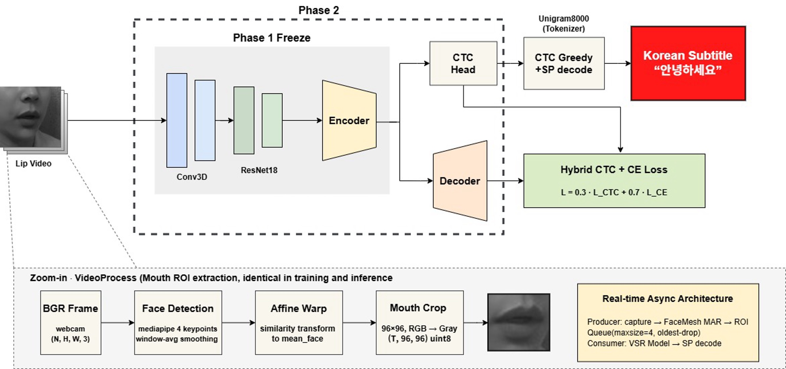
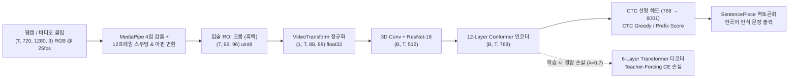
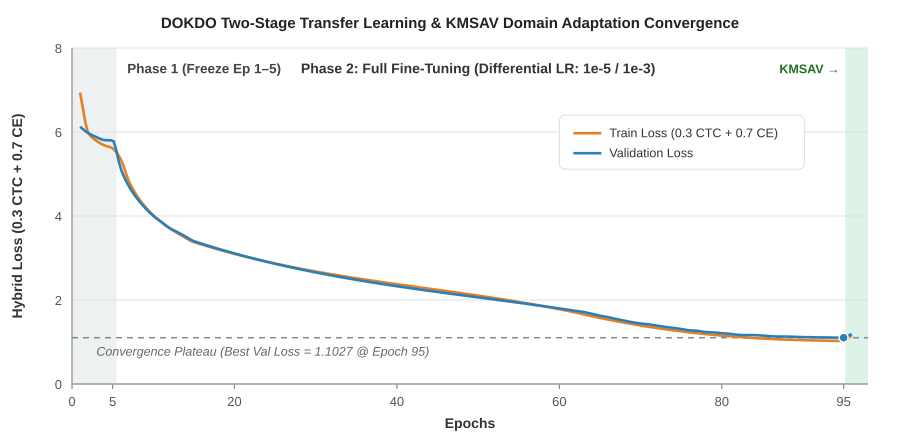
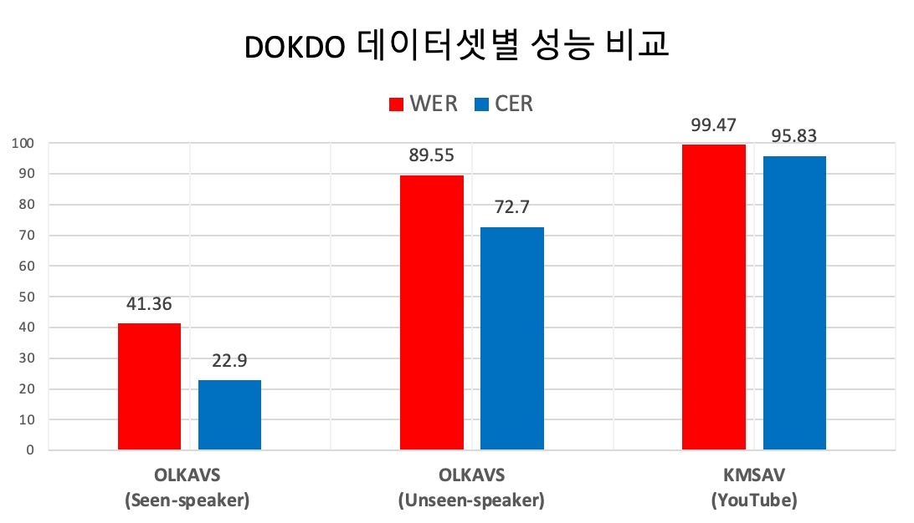

<div align="center">

# DOKDO: 2단계 전이학습 기반 온디바이스 한국어 입술 독순 시스템

**전이학습 기반 온디바이스 한국어 립리딩 시스템의 실환경 검증**  
*(Real-World Validation of an On-Device Korean Lip-Reading System Based on Transfer Learning)*

[](https://huggingface.co/dlvusgks/dokdo-vsr)
[](https://www.python.org/)
[](https://pytorch.org/)
[](#)
[](LICENSE)

<h3>
  <a href="README.md"><b>🇺🇸 English</b></a> &nbsp;|&nbsp; <b>🇰🇷 한국어 (Korean)</b>
</h3>



<p align="center">
  <b>그림 1.</b> DOKDO 전체 시스템 아키텍처: (좌) 비동기 MAR 기반 생산자–소비자(Producer–Consumer) 실시간 웹캠 파이프라인, (중) 3D-CNN + ResNet-18 + 12-Layer Conformer 시각적 백본, (우) 한국어 SentencePiece Unigram(8,001 토큰) 및 CTC + Attention CE 혼합 손실 기반 2단계 전이학습 구조.
</p>

</div>

---

## 📑 목차 (Table of Contents)
1. [프로젝트 개요 및 핵심 기여](#1-프로젝트-개요-및-핵심-기여)
2. [베이스 모델 상속 구조 vs. DOKDO 한국어 자체 구현](#2-베이스-모델-상속-구조-vs-dokdo-한국어-자체-구현)
3. [모델 아키텍처 및 입출력 텐서 파이프라인](#3-모델-아키텍처-및-입출력-텐서-파이프라인)
4. [2단계 차등 학습률 전이학습 및 하이브리드 손실 함수](#4-2단계-차등-학습률-전이학습-및-하이브리드-손실-함수)
5. [정량적·정성적 실험 결과 (OLKAVS & KMSAV)](#5-정량적정성적-실험-결과-olkavs--kmsav)
6. [온디바이스 웹캠 파이프라인 및 처리 시간 측정 프로토콜](#6-온디바이스-웹캠-파이프라인-및-처리-시간-측정-프로토콜)
7. [저장소 디렉토리 구조 및 코드 매핑](#7-저장소-디렉토리-구조-및-코드-매핑)
8. [설치 및 단계별 재현 명령어 (End-to-End)](#8-설치-및-단계별-재현-명령어-end-to-end)

---

## 1. 프로젝트 개요 및 핵심 기여

**시각적 음성인식(Visual Speech Recognition, VSR)** 또는 **입술 독순(Lip-Reading)**은 오디오 신호 없이 화자의 입술 움직임만으로 발화 문장을 복원하는 기술입니다. 기존 한국어 독순 연구들은 대부분 고립 단어 분류에 머물거나, 학습된 토크나이저·가중치·전처리 및 실시간 웹캠 구동 코드를 공개하지 않아 재현과 실환경 검증에 한계가 있었습니다.

**DOKDO**는 대규모 영어 VSR 백본([Auto-AVSR](https://github.com/mpc001/auto_avsr) / [Chaplin](https://github.com/amanvirparhar/chaplin))의 시공간적 시각 표현을 한국어로 전이학습하고, 외부 서버 통신 없이 단일 소비자용 노트북(MacBook Pro M5 Pro CPU)과 내장 웹캠만으로 동작하는 **온디바이스 한국어 문장 단위 독순 시스템**을 구현 및 검증합니다.

* **한국어 SentencePiece Unigram 서브워드 사전 (`8,001` 토큰)**: 어간·어미·조사가 결합하는 한국어 교착어 특성에 맞추어 기존 영어 출력층(5,049 클래스)을 8,000개 한국어 서브워드 조각과 전용 CTC Blank 토큰(`id=8000`)으로 구성된 **8,001차원 한국어 출력 계층**으로 재설계하였습니다.
* **2단계 차등 학습률 전이학습 및 도메인 적응**: 초기 5 에폭 동안 시각 백본을 동결하여 무작위 초기화된 한국어 헤드를 안정화(Phase 1)한 뒤, 백본(`1e-5`)과 한국어 헤드/디코더(`1e-3`)에 100배 차등 학습률을 부여하고 하이브리드 손실($L = 0.3 L_{\text{CTC}} + 0.7 L_{\text{CE}}$)로 미세조정(Phase 2)하였습니다. 이를 통해 AI Hub OLKAVS Seen-speaker 벤치마크에서 **CER 22.90%, WER 41.36%**를 달성하여 동일 데이터셋 기반 기존 시각 단독 한국어 VSR 연구 대비 **CER을 14.37%p 단축**하였습니다.
* **온디바이스 비동기 실시간 웹캠 파이프라인**: MediaPipe 4-키포인트 아핀 정규화 크롭과 3D 입술 종횡비(MAR) 기반 자동 발화 감지기 및 비동기 Producer–Consumer 큐(`maxsize=4`)를 결합하여, Apple M5 Pro CPU 환경에서 **평균 5.0초 발화 기준 6.61초**의 온디바이스 종단간 처리 시간을 달성하였습니다.

---

## 2. 베이스 모델 상속 구조 vs. DOKDO 한국어 자체 구현

기존 영어 사전학습 모델에서 상속한 백본 모듈과 본 프로젝트(DOKDO)에서 한국어 독순 및 온디바이스 실시간 추론을 위해 자체 설계·구현한 컴포넌트의 구분은 다음과 같습니다.

| 구성 요소 / 단계 | 출처 구분 | 파라미터 수 | 상세 규격 및 역할 | 관련 소스 코드 |
| :--- | :---: | :---: | :--- | :--- |
| **Visual Frontend** | 베이스 상속<br>(LRS3 사전학습) | `~11.2M` | 3D Conv (`5x7x7`, 시간 stride 1) + 2D ResNet-18로 프레임당 512차원 시각 특징 추출 | `espnet/nets/pytorch_backend/backbones/` |
| **Conformer Encoder** | 베이스 상속<br>(Phase 2 미세조정) | `~231.4M` | 12-Layer Conformer (`adim=768`, `aheads=12`, `eunits=3072`, Macaron FFN + MHSA + Conv `kernel=31`) | `espnet/nets/pytorch_backend/conformer/` |
| **한국어 토크나이저** | **DOKDO 자체 구현** | `8,001` 어휘 | 한국어 SentencePiece Unigram (`<unk>=0, <s>=1, </s>=2`, 서브워드 `3..7999`, `CTC blank=8000`) | `Train/train_tokenizer.py`<br>`Train/tokenizer_utils.py` |
| **한국어 출력 헤드 & 디코더** | **DOKDO 자체 구현** | `~12.3M` | 기존 영어 헤드(5,049)를 제거하고 8,001차원 한국어 `ctc.ctc_lo` 및 6-Layer Transformer Decoder로 교체 | `Train/model.py`<br>`pipelines/model_korean.py` |
| **2단계 차등 전이학습** | **DOKDO 자체 구현** | 총 `254.9M` | Phase 1(1–5 에폭 백본 동결) $\rightarrow$ Phase 2(6–109 에폭 차등 학습률 `1e-5` vs `1e-3`) + 혼합 손실($0.3 L_{\text{CTC}} + 0.7 L_{\text{CE}}$) 및 OLKAVS $\rightarrow$ KMSAV 2차 적응 | `Train/train.py`<br>`Train/plot_loss.py` |
| **온디바이스 웹캠 파이프라인** | **DOKDO 자체 구현** | — | MediaPipe 4점 아핀 입술 크롭(`96x96` $\rightarrow$ `88x88`) + 수동 벤치마크 및 비동기 MAR Producer–Consumer 큐(`Queue(maxsize=4)`) | `demo_webcam.py`<br>`util/lip_tracker_dokdo.py`<br>`pipelines/pipeline_korean.py` |

---

## 3. 모델 아키텍처 및 입출력 텐서 파이프라인



| 파이프라인 단계 | 텐서 차원 (Shape) | 데이터 타입 | 수행 연산 및 주요 파라미터 |
| :--- | :---: | :---: | :--- |
| **1. 원본 비디오 프레임** | `(T, H, W, 3)` | `uint8` | `1280x720 @ 25fps` RGB 프레임 시퀀스 |
| **2. 입술 ROI 추출 (`VideoProcess`)** | `(T, 96, 96)` | `uint8` | MediaPipe 4점 랜드마크 검출 $\rightarrow$ 12프레임 이동평균 스무딩 $\rightarrow$ LRS3 평균 얼굴(`256x256`) 기준 유사 아핀 변환(Similarity Affine Warp) $\rightarrow$ `96x96` 흑백 입술 크롭 |
| **3. 공간 변환 및 정규화 (`VideoTransform`)** | `(B, 1, T, 88, 88)` | `float32` | `/ 255.0` 스케일링 $\rightarrow$ `88x88` 크롭 (학습: RandomCrop + HorizontalFlip(0.5) / 추론: CenterCrop) $\rightarrow$ `Normalize(mean=0.421, std=0.165)` |
| **4. 시공간 시각 프론트엔드** | `(B, T, 512)` | `float32` / `bf16` | 3D Conv (`5x7x7`, 시간 stride 1) + 2D ResNet-18 |
| **5. Conformer 인코더** | `(B, T, 768)` | `float32` / `bf16` | 12개 Conformer 블록 (`adim=768`, `eunits=3072`, `aheads=12`, `cnn_kernel=31`) |
| **6. 한국어 출력 헤드 및 디코딩** | `(B, T, 8001)` | `float32` | `ctc.ctc_lo` 선형 투영 $\rightarrow$ CTC Greedy ($\arg\max \rightarrow$ 연속 중복 제거 $\rightarrow$ `blank=8000` 제거) $\rightarrow$ SentencePiece 역토큰화 |

---

## 4. 2단계 차등 학습률 전이학습 및 하이브리드 손실 함수

### 4.1 CTC + Attention 교차 엔트로피 하이브리드 손실 함수
모델 학습 시(`Train/model.py`, `Train/train.py`) 프레임 단위 시간 정렬을 강제하는 CTC 손실과 자기회귀 Transformer 디코더의 Cross-Entropy 손실(Label Smoothing `0.1`)을 결합하여 최적화합니다:

$$L = \lambda L_{\text{CTC}} + (1 - \lambda) L_{\text{CE}}, \quad \lambda = 0.3$$

* **학습(Training) 경로와 온디바이스 추론(Inference) 경로의 구분**:
  * **학습 시**: CTC 헤드($\lambda = 0.3$)와 6-Layer Transformer 디코더($1 - \lambda = 0.7$, `sos_id=1, eos_id=2` Teacher-Forcing)를 동시에 활성화하여 Conformer 인코더가 한국어 어순과 문맥 표현을 내재화하도록 유도합니다.
  * **온디바이스 추론 시 (`decode=ctc`, 기본값)**: CPU 환경에서 지연 시간의 주된 병목인 자기회귀 디코더를 우회하고 **Visual Frontend + Conformer Encoder + CTC 선형 헤드(`ctc.ctc_lo`) 기반 CTC Greedy 디코딩**만 수행하여 고속 온디바이스 추론을 달성합니다. 필요 시 `--decode hybrid` 옵션으로 Joint CTC/Attention 빔 서치도 선택할 수 있습니다.

### 4.2 2단계 차등 학습률 스케줄 및 손실 수렴 곡선

<div align="center">
  
  <p align="center"><b>그림 2.</b> Phase 1(백본 동결, Epoch 1–5), Phase 2(차등 학습률 전체 미세조정, Epoch 6–95) 및 Stage 2 KMSAV 도메인 적응 과정의 학습·검증 손실 수렴 곡선.</p>
</div>

| 학습 단계 | 에폭 구간 | 학습 대상 모듈 | 동결 모듈 | 학습률 설정 (`AdamW`, `wd=0.01`) | 설계 목적 및 동작 원리 |
| :--- | :---: | :--- | :--- | :---: | :--- |
| **Phase 1<br>(헤드 웜업)** | **Epoch 1 – 5** | 한국어 CTC 헤드 + 디코더<br>(`12.3M` 파라미터) | Visual Frontend + Conformer 인코더 (`242.6M` 파라미터) | `LR_HEAD = 1e-3`<br>(3에폭 선형 웜업 + Cosine) | 무작위 초기화된 8,001차원 한국어 출력층의 초기 큰 기울기가 사전학습된 시각 백본을 손상시키는 현상 방지 |
| **Phase 2<br>(전체 미세조정)** | **Epoch 6 – 109** | **전체 네트워크**<br>(`254.9M` 파라미터) | 없음 (전체 동결 해제) | `LR_ENCODER = 1e-5`<br>`LR_HEAD = 1e-3`<br>(CosineAnnealingLR) | 백본에 100배 낮은 학습률을 적용하여 시각 특징의 치명적 망각(Catastrophic Forgetting) 없이 한국어 조음 패턴에 적응 |
| **Stage 2 도메인 적응<br>(OLKAVS $\rightarrow$ KMSAV)** | 순차 미세조정 | 전체 네트워크 | 동일한 Phase 1 $\rightarrow$ 2 스케줄 | `--pretrained_kr_ckpt`로 OLKAVS 최적 가중치 로드 | 통제된 스튜디오 환경(OLKAVS, ~1.5 TB)에서 학습된 한국어 모델을 야생 유튜브 환경(KMSAV, ~100 GB)으로 적응 |

---

## 5. 정량적·정성적 실험 결과 (OLKAVS & KMSAV)

### 5.1 정량적 벤치마크 성능 비교

> 📌 **"자연발화(Natural Sentence Utterances)" 용어 정의**: 본 문서에서 *자연발화*는 비통제 자유 대화(spontaneous speech)가 아니라, 기존 한국어 독순 연구의 고립 단어·숫자 분류와 대비되는 **일상 어휘와 조사가 포함된 연속된 문장 단위의 발화(continuous sentence-level utterances)**를 의미합니다.

| 모델 / 연구 | 입력 모달리티 | 백본 및 디코딩 구조 | 데이터셋 | 평가 분할 조건 | WER (%) | CER (%) | 코드/가중치 공개 | 온디바이스 웹캠 검증 |
| :--- | :---: | :--- | :--- | :---: | :---: | :---: | :---: | :---: |
| **Cho & Yoon (2024)** | Visual-only | 3D-CNN + ResNet-18 + Transformer (CTC) | AI Hub (OLKAVS) | Seen-speaker | — | 37.27 | 미공개 | 미검증 |
| **KM-AVSR (2025)** | Audio + Visual | Multimodal Backbone + LLM | AI Hub (OLKAVS) | Seen-speaker | — | 15.66 | 미공개 | 미검증 |
| **DOKDO (Ours)** | **Visual-only** | **Auto-AVSR Conformer + SentencePiece (8,001)** | **OLKAVS (~1.5 TB)** | **Seen-speaker** | **41.36** | **22.90** | **공개** | **검증 완료** |
| **DOKDO (Ours)** | **Visual-only** | **Auto-AVSR Conformer + SentencePiece (8,001)** | **OLKAVS (~1.5 TB)** | **Unseen-speaker** | 89.55 | 72.70 | **공개** | **검증 완료** |
| **DOKDO (Ours)** | **Visual-only** | **Auto-AVSR Conformer + SentencePiece (8,001)** | **KMSAV (~100 GB)** | **In-the-wild (유튜브)** | 99.47 | 95.83 | **공개** | **검증 완료** |

### 5.2 정성적 추론 예시 및 한국어 독순 오류 분석

| 구분 | 정답 문장 (`REF`) | 모델 예측 문장 (`PRED`) | 조음 음성학적 및 시각적 분석 |
| :--- | :--- | :--- | :--- |
| **실시간 웹캠 데모** | `요즘 연애를 하고 싶은데 일상이 바빠서 할 수가 없어.` | `요즘 연애 하고 싶은데 일상 바빠서 할수` | 핵심 내용어(`요즘`, `연애`, `하고 싶은데`, `일상`, `바빠서`, `할수`)는 정확히 복원되었으며, 입술 개구도가 작은 단모음 조사(`를`, `이`)와 문미 종결부(`가 없어`)가 생략됨. |
| **완전/근접 일치 사례<br>(OLKAVS 평가셋)** | `오늘 응급실에 다녀왔어.`<br>`병원에 가기 귀찮아.`<br>`건강검진 빨리해야겠다.`<br>`사랑하는 사람과 곧 결혼하게 돼서 기뻐.` | `오늘 응급실에 다녀왔어.`<br>`병원에 가기 귀찮아.`<br>`건강검진 빨리해야겠다.`<br>`사랑하 사람과 곧 결혼하 돼서 기뻐.` | 양순음(`ㅁ, ㅂ, ㅍ`)과 원순모음(`ㅗ, ㅜ`)처럼 입술 돌출·폐쇄가 뚜렷한 음소가 포함된 문장에서 높은 음절·어절 복원율을 보임. |
| **동형구형음(Homophene) 및 조사 변이** | `어머니가 치매라서 요양원을 알아봐야 해서 혼란스러워.`<br>`건강이 안 좋으니 비통함이 느껴져.` | `어머니 치매라 요양원 알아봐야 해서 혼란스러워.`<br>`건강이 안 좋으니 비통함 느껴져.` | 입안 내부(연구개·치조)에서 조음되어 외부 입 모양이 유사한 받침 및 짧은 조사(`가`, `을`, `이`)가 일부 탈락하나 문장의 핵심 의미는 보존됨. |

---

## 6. 온디바이스 웹캠 파이프라인 및 처리 시간 측정 프로토콜

<div align="center">
  
  <p align="center"><b>그림 3.</b> MacBook Pro(M5 Pro, CPU)에서 구동 중인 온디바이스 실시간 웹캠 추론 및 한국어 자막 오버레이 화면.</p>
</div>

### 6.1 두 가지 웹캠 실행 모드 (`demo_webcam.py`)
1. **수동 스페이스바 E2E 벤치마크 모드 (`python demo_webcam.py --mode manual`, 기본값)**
   * `SPACE` 키를 눌러 발화 구간 녹화(`1280x720 @ 25fps`)를 시작 및 종료합니다.
   * 녹화 종료 즉시 `KoreanInferencePipeline.forward_with_timing()`이 MediaPipe 전처리(`t_preprocess`)와 VSR 추론(`t_infer`)을 연속 수행하고, 단계별 소요 시간과 RTF를 콘솔 및 `result_korean.txt`에 기록합니다.
2. **비동기 MAR 생산자–소비자 자동 감지 모드 (`python demo_webcam.py --mode async`)**
   * **생산자 스레드 (`util/lip_tracker_dokdo.py`)**:
     1. **3초 정면 자동 캘리브레이션**: 초기 3초간 입을 다문 상태에서 3D 입술 종횡비(MAR)를 측정하여 개인화된 개구 임계값(`OPEN_THRESHOLD = mean(MAR) + 0.04`)을 설정합니다.
     2. **15프레임 Pre-Roll 링 버퍼 (`deque(maxlen=15)`)**: 발화 시작 직전 15프레임을 상시 보존하여 어두(초성) 입술 움직임 유실을 방지합니다.
     3. **1.0초 침묵 트리거 및 2단계 유효성 검증**: 입을 다문 침묵 상태가 1.0초 지속되면 발화 종료로 판단하고, `total_frames > 20` 및 `valid_mar_frames >= 5` 조건을 검증한 뒤 `VideoProcess`를 통해 `(T, 96, 96)` `uint8` 입술 ROI 배열을 생성합니다.
     4. **비차단 유한 큐 (`queue.Queue(maxsize=4)`)**: 큐가 가득 찬 경우 가장 오래된 항목을 버리는(oldest-drop) 정책으로 `(T, 96, 96)` 클립을 전달하여 카메라 루프의 블로킹을 방지합니다.
   * **소비자 스레드 (`demo_webcam.py`)**: 백그라운드 데몬 스레드에서 `(T, 96, 96)` 클립을 꺼내 `88x88` 정규화 및 `KoreanAVSR.infer()` 추론을 수행하고 실시간 비디오 화면 하단에 한국어 자막을 렌더링합니다.

### 6.2 종단간 처리 시간 측정 프로토콜 (`5.0초` 발화 $\rightarrow$ `6.61초` 처리)

| 측정 항목 | 상세 규격 |
| :--- | :--- |
| **하드웨어 장치** | Apple MacBook Pro (M5 Pro, 48 GB 통합 메모리) |
| **연산 백엔드** | CPU 단독 구동 (`15-core ARM64`, `device="cpu"`, FP32) |
| **카메라 해상도 및 FPS** | `1280 x 720 @ 25 fps` |
| **기준 발화 길이** | 평균 **5.0초** (`~125 프레임 @ 25fps`, 예: *"요즘 연애를 하고 싶은데 일상이 바빠서 할 수가 없어."*) |
| **측정 구간 정의** | **사용자가 발화하는 녹화 시간(5.0초)은 제외함.**<br>• $t_0$: 발화 캡처 종료 시점<br>• $t_1$: MediaPipe 4점 검출, 12프레임 스무딩, 아핀 변환 및 `96x96` $\rightarrow$ `88x88` 정규화 완료 시점 (`t_preprocess` $= t_1 - t_0$)<br>• $t_2$: Conformer 인코더 순전파, CTC Greedy 디코딩 및 SentencePiece 역토큰화 완료 시점 (`t_infer` $= t_2 - t_1$)<br>• **총 처리 지연 시간 (`t_total`)**: $t_2 - t_0 = t_{\text{preprocess}} + t_{\text{infer}}$ |
| **평균 총 처리 시간** | **6.61초** ($\text{RTF} = 6.61 / 5.0 \approx 1.32$) |

---

## 7. 저장소 디렉토리 구조 및 코드 매핑

```text
DOKDO-VSR/
├── README.md                        # 메인 문서 (영문 기본 페이지)
├── README_KO.md                     # 한국어 상세 문서
├── requirements.txt                 # Python 패키지 의존성 목록
├── demo_webcam.py                   # 온디바이스 웹캠 데모 (--mode manual | --mode async)
├── configs/
│   └── korean.ini                   # 추론 런타임 설정 (model_path, spm_model, decode=ctc|hybrid)
├── util/
│   └── lip_tracker_dokdo.py         # 비동기 MAR 발화 감지 Producer 및 Queue(maxsize=4) 관리 모듈
├── pipelines/
│   ├── pipeline_korean.py           # 한국어 종단간 추론 파이프라인 (forward & forward_with_timing)
│   ├── model_korean.py              # KoreanAVSR 래퍼 (CTC Greedy 및 KoreanCTCPrefixScorer 빔 서치)
│   ├── data/
│   │   ├── data_module.py           # 비디오 로더 및 전처리 연결 모듈
│   │   └── transforms.py            # VideoTransform (88x88 크롭 및 Normalize(0.421, 0.165))
│   └── detectors/mediapipe/
│       ├── detector.py              # MediaPipe 4-키포인트 얼굴 랜드마크 검출기
│       └── video_process.py         # 12프레임 윈도우 스무딩, 유사 아핀 변환, 96x96 입술 크롭
├── Train/
│   ├── preprocess.py                # 원본 MP4 + AI Hub JSON -> 문장 단위 (T, 96, 96) .npz (8:1:1 분할)
│   ├── train_tokenizer.py           # 한국어 SentencePiece Unigram (8,000 조각) 토크나이저 학습 스크립트
│   ├── tokenizer_utils.py           # KoreanTokenizer 래퍼 (vocab_size=8,001, blank_id=8000)
│   ├── dataset.py                   # KoreanVSRDataset 및 가변 길이 패딩 collate_fn
│   ├── model.py                     # KoreanVSRModel (8,001 헤드 교체 및 Hybrid CTC + Decoder CE 손실)
│   ├── train.py                     # 2단계 차등 학습률 전이학습 및 KMSAV 도메인 적응 학습 스크립트
│   ├── evaluate.py                  # CER(음절 편집 거리) 및 WER(어절 편집 거리) 정량 평가 스크립트
│   └── plot_loss.py                 # 2단계 전이학습 손실 수렴 곡선 시각화 스크립트
├── benchmarks/LRS3/models/
│   └── LRS3_V_WER19.1/model.json    # Auto-AVSR Conformer 백본 하이퍼파라미터 설정 파일
└── assets/
    ├── pipeline.jpeg                # 전체 시스템 아키텍처 다이어그램
    ├── result.jpeg                  # 실시간 온디바이스 웹캠 데모 실행 화면
    └── training_curve.svg           # 2단계 전이학습 및 KMSAV 도메인 적응 손실 수렴 그래프
```

---

## 8. 설치 및 단계별 재현 명령어 (End-to-End)

### Step 1. 가상환경 생성 및 패키지 설치
```bash
git clone https://github.com/sangdeok-EE/DOKDO-VSR.git
cd DOKDO-VSR

conda create -n dokdo-vsr python=3.10 -y
conda activate dokdo-vsr
pip install -r requirements.txt
```

### Step 2. 사전학습 가중치 및 토크나이저 준비
1. **한국어 VSR 모델 가중치 (`korean_vsr_hybrid.pt`)**:  
   [HuggingFace (`dlvusgks/dokdo-vsr`)](https://huggingface.co/dlvusgks/dokdo-vsr)에서 `korean_vsr_hybrid.pt`를 다운로드하여 저장소 루트 경로(`DOKDO-VSR/korean_vsr_hybrid.pt`)에 배치합니다.
2. **한국어 SentencePiece 토크나이저 (`pipelines/tokens/unigram8000.model`)**:
   > ⚠️ **라이선스 안내**: SentencePiece 어휘 사전은 AI Hub 한국어 립리딩 말뭉치(OLKAVS / KMSAV)로부터 직접 유도되었으므로, AI Hub 데이터 배포 정책을 준수하기 위해 바이너리 `.model` 파일은 공개 저장소에 직접 포함하지 않습니다.
   * 이미 `unigram8000.model` 파일을 보유한 경우 `pipelines/tokens/unigram8000.model` 경로에 배치합니다.
   * AI Hub JSON 라벨 디렉토리 또는 전처리된 `.npz` 파일로부터 직접 생성하려면 아래 명령어를 실행합니다:
     ```bash
     python Train/train_tokenizer.py \
         --json_dir /path/to/OLKAVS/json_labels \
         --output_prefix pipelines/tokens/unigram8000 \
         --vocab_size 8000
     ```

### Step 3. 데이터 전처리 (`MP4 + JSON` $\rightarrow$ `.npz`)
```bash
python Train/preprocess.py \
    --data_root /path/to/raw_videos \
    --json_root /path/to/json_labels \
    --output_dir data/preprocessed \
    --detector mediapipe \
    --train_ratio 0.8 --val_ratio 0.1 --seed 42
```

### Step 4. 2단계 차등 학습률 전이학습 (Stage 1: OLKAVS $\rightarrow$ Stage 2: KMSAV)
```bash
# [Stage 1] OLKAVS 2단계 전이학습 (Phase 1: 5 에폭 백본 동결 -> Phase 2: 차등 학습률 1e-5 / 1e-3, 혼합 손실 0.3 CTC + 0.7 CE)
python Train/train.py \
    --train_dir data/preprocessed/train \
    --val_dir data/preprocessed/validation \
    --test_dir data/preprocessed/test \
    --chaplin_checkpoint benchmarks/LRS3/models/LRS3_V_WER19.1/model.pth \
    --model_conf benchmarks/LRS3/models/LRS3_V_WER19.1/model.json \
    --spm_model pipelines/tokens/unigram8000.model \
    --output_dir Train/output_olkavs \
    --loss_type hybrid --ctc_weight 0.3 \
    --freeze_epochs 5 --lr_encoder 1e-5 --lr_head 1e-3 \
    --epochs 109 --batch_size 8 --grad_accum 2

# [Stage 2] KMSAV 야생(In-the-Wild) 도메인 적응 (OLKAVS 최적 체크포인트에서 이어서 미세조정)
python Train/train.py \
    --train_dir data/kmsav_preprocessed/train \
    --val_dir data/kmsav_preprocessed/validation \
    --pretrained_kr_ckpt Train/output_olkavs/checkpoints/best_model.pt \
    --model_conf benchmarks/LRS3/models/LRS3_V_WER19.1/model.json \
    --spm_model pipelines/tokens/unigram8000.model \
    --output_dir Train/output_kmsav \
    --loss_type hybrid --ctc_weight 0.3 \
    --freeze_epochs 5 --lr_encoder 1e-5 --lr_head 1e-3
```

### Step 5. 정량적 성능 평가 (CER & WER)
```bash
# 1) 기본 추론 경로: CTC Greedy 디코딩
python Train/evaluate.py \
    --test_dir data/preprocessed/test \
    --checkpoint korean_vsr_hybrid.pt \
    --spm_model pipelines/tokens/unigram8000.model \
    --decode ctc \
    --output_file eval_result_ctc.txt

# 2) 하이브리드 추론 경로: Joint CTC/Attention 빔 서치
python Train/evaluate.py \
    --test_dir data/preprocessed/test \
    --checkpoint korean_vsr_hybrid.pt \
    --spm_model pipelines/tokens/unigram8000.model \
    --decode hybrid --ctc_weight 0.3 --beam_size 10 \
    --output_file eval_result_hybrid.txt
```

### Step 6. 온디바이스 실시간 웹캠 데모 실행
```bash
# 모드 A: 수동 스페이스바 녹화 + 단계별 지연 시간 계측 (5.0초 발화 -> 6.61초 처리)
python demo_webcam.py --mode manual --decode ctc

# 모드 B: 비동기 MAR 자동 발화 감지 Producer-Consumer 큐 파이프라인
python demo_webcam.py --mode async --decode ctc
```

---

## 🙏 감사의 글 및 라이선스 (Acknowledgments & License)

* 본 프로젝트는 Imperial College London의 [Auto-AVSR](https://github.com/mpc001/auto_avsr) 및 [Chaplin](https://github.com/amanvirparhar/chaplin), 그리고 [ESPnet](https://github.com/espnet/espnet)을 기반으로 구축되었습니다.
* 한국어 입술 독순 데이터셋(**OLKAVS**, **KMSAV**)은 [AI Hub](https://www.aihub.or.kr/)에서 제공받았습니다.
* 본 저장소는 [Apache-2.0 License](LICENSE)를 따릅니다.
